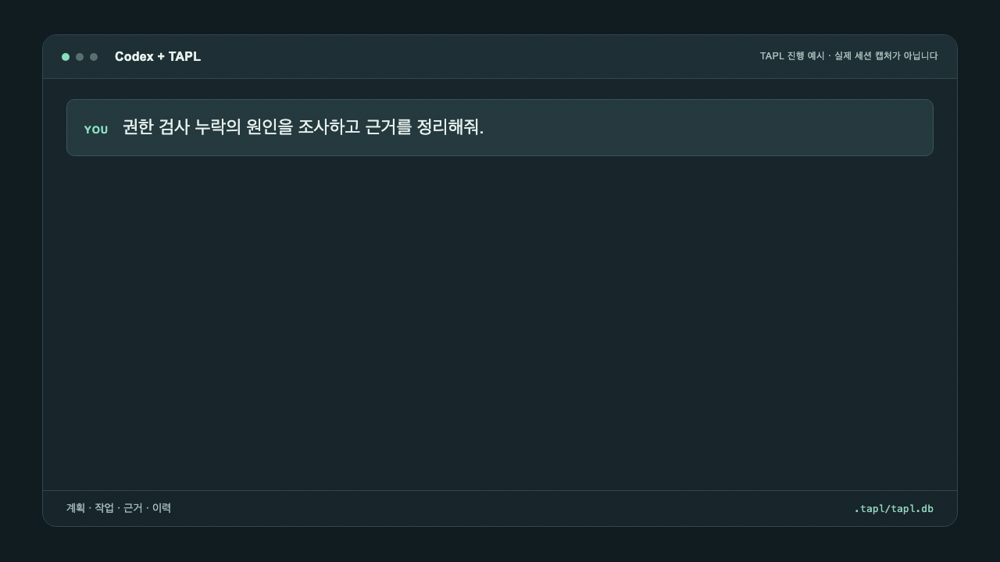
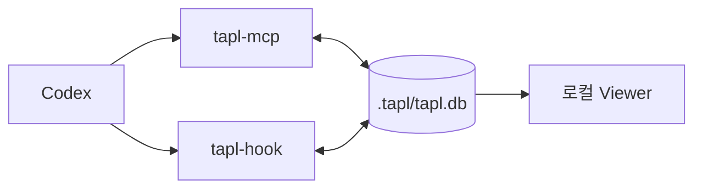

<p align="center">
  
</p>
<h1 align="center">tapl</h1>
<p align="center"><strong>코딩 에이전트에게 기억을.</strong></p>
<p align="center">요청부터 계획, 발견 사항, 완료 기록까지 코드 옆에 남겨 다음 세션에서도 이어갑니다.</p>

<p align="center">
  <a href="README.md">English</a> · <strong>한국어</strong>
</p>
<p align="center">
  <a href="https://github.com/qkdxorjs1002/tapl/releases"></a>
  <a href="docs/getting-started/installation.ko.md"></a>
  <a href="LICENSE.md"></a>
</p>
<p align="center">
  <a href="#quick-start">빠른 시작</a> · <a href="#associative-memory">연상 기억</a> · <a href="#workflow">진행 예시</a> · <a href="docs/README.ko.md">문서</a>
</p>

## 왜 TAPL인가요?

대화가 길어지거나 세션이 바뀌어도, 작업의 맥락은 세션 작업 폴더에 남아 있어야 합니다.
TAPL은 Codex의 요청, 계획, 승인, 작업, 발견 사항과 이력을 로컬 SQLite 데이터베이스에 보관합니다.

- **중단한 곳에서 이어갑니다.** 완료한 일과 남은 일을 다시 설명할 필요가 줄어듭니다.
- **코드 옆에 기록합니다.** Codex 세션 작업 폴더의 `.tapl/tapl.db`에 작업 상태와 근거가 함께 남습니다.
- **이전 결정을 찾습니다.** 전문 검색을 기본 제공하며, 시맨틱 검색을 선택할 수 있습니다.
- **관련 경험을 떠올립니다.** 연상 기억이 과거 작업의 짧은 단서를 제공하고 원본 기록으로 연결합니다.
- **진행 상황을 확인합니다.** 대화의 단계별 안내와 로컬 viewer로 계획과 작업 상태를 살펴봅니다.
- **병렬 작업의 경계를 정합니다.** 작업 의존성과 파일 소유 범위를 확인해 위임을 조율합니다.

<a id="associative-memory"></a>

## 연상 기억

“그때 이렇게 구현했던 것 같은데…”라는 생각이 관련 자료를 다시 찾게 하듯,
TAPL의 연상 기억은 현재 작업과 과거 기록 사이를 이어 주는 짧은 단서입니다.
에이전트는 단서에서 출발해 원본을 확인하고, 지금 작업에 적용할 수 있는지 판단합니다.

예를 들어 마이그레이션을 수정할 때 “이전에는 트랜잭션 경계를 확인했었지”라는
기억이 떠오르면, 연결된 작업 기록을 열어 당시 구현과 검증 결과를 확인할 수 있습니다.

1. **남길 경험을 고릅니다.** 작업 완료 시 검증한 결정, 재사용할 해결법, 주의점 등을 최대 2개 기록할 수 있습니다. 각 기억은 240자 이하 메모, 단서 3–5개, 원본 작업이나 기록의 참조로 구성됩니다.
2. **필요할 때 떠올립니다.** 새 작업을 정리할 때 한 번, 관련 단서를 최대 3개 컨텍스트에 제공합니다. 에이전트는 연결된 원문을 확인한 뒤 활용합니다.
3. **실제로 쓰인 기억을 강화합니다.** 원문을 확인하고 작업에 사용했다고 기록한 기억은 더 오래 유지됩니다. 단순히 보거나 검색한 것만으로는 강화되지 않습니다.

사용하지 않는 기억의 강도는 서서히 줄어들지만, 오래됐다는 이유만으로 삭제되지는 않습니다.
기존 SQLite와 전문 검색을 사용하므로 별도 임베딩 모델이나 상주 프로세스 없이 동작합니다.

웹·VS Code Viewer에서 기억의 목록·검색·상세·원문을 조회할 수 있습니다.
전체 저장 수와 검색 일치 수를 구분하고 최근 기억 저장 실패도 확인할 수 있습니다.
기억을 수정하거나 삭제하려면 에이전트에게 명시적으로 요청하세요.

작업 완료 시 에이전트는 기억 저장 또는 사유를 포함한 명시적 건너뛰기 결정을 기록합니다.
완료 응답 전체를 확인하고 미해결 기억 오류를 해소한 뒤 run을 보관합니다.
작업 결과는 기억 처리와 별도로 저장됩니다. 짧은 1–2문장은 권장사항이며,
240자 제한·단서 3–5개·원본 참조는 필수입니다.

자동 기록·회상·강화는 기본으로 켜져 있습니다. 수동 조회·관리는 유지하면서 끄려면:

```sh
taplctl config set recall.enabled false
# 기본값으로 복원:
taplctl config unset recall.enabled
```

세부 기준과 제한은 [연상 기억 안내](docs/guides/memory.ko.md)를 참고하세요.

<a id="workflow"></a>

## 작업 흐름 보기

PLAN·TASK 작성 상세도는 `정확하게(precise, 기본)`·`보통(normal)`·`최소(minimal)`로 선택할 수 있습니다.
보통·최소는 고정 개수나 길이 제한 없이 본문과 불필요한 TASK 분할을 줄입니다.

```sh
taplctl config set workflow.authoring_detail normal
# 기본 동작으로 복원:
taplctl config unset workflow.authoring_detail
```

옵션별 동작과 설정 범위는 [설정 가이드](docs/guides/authoring-detail.ko.md),
실측 비교는 [벤치마크](docs/reference/benchmarks.ko.md)를 참고하세요.

Codex에게 평소처럼 요청하세요.

> 권한 검사 누락의 원인을 조사하고 근거를 정리해줘.

한 요청에 독립적인 주제가 여러 개 있으면 Codex는 하나의 RUN 안에 주제별 PLAN을 모두 작성한 뒤 TASK를 설계합니다. 예를 들어 아래 네 주제를 함께 요청하면 다음처럼 나눕니다.

| PLAN | 주제 |
| --- | --- |
| PLAN-001 | 불규칙 호스트명 정규식 필터링 |
| PLAN-002 | 분석용 기본 Codex CLI 환경 |
| PLAN-003 | 모델 추론 레벨 설정 |
| PLAN-004 | 웹 페이지 요소를 통한 광고 탐지 |

각 PLAN은 자체 요구사항·접근 방식·검증을 담고, 각 TASK는 `spec_id`로 해당 주제의 PLAN을 참조합니다. 한 결과를 위한 단계·제약·예시·테스트는 함께 유지합니다. 별도 RUN 수명주기는 사용자가 명시적으로 요청할 때만 나눕니다.

같은 작업 폴더에서 여러 Codex 세션을 열면 각 세션은 자신의 RUN으로 동시에 작업합니다. 한 RUN의 소유 세션은 하나이며, 같은 세션을 재개하면 해당 RUN을 이어갑니다. 다른 세션의 승인·TASK·분할 큐·종료·아카이브에는 영향을 주지 않습니다. Viewer에서는 활성 RUN을 선택해 읽을 수 있습니다.

Codex hook이 전달하는 `session_id`를 모든 `tapl_*` MCP 호출에 그대로 포함합니다. 식별자를 생략한 기존 클라이언트는 별도 legacy 범위만 조회하며, 세션별 기록이 있는 작업 영역에서 식별자 없는 변경 호출은 거부됩니다. 기존 DB의 RUN은 legacy 범위로 보존하고, 스키마 업그레이드 전에 `.tapl/tapl.db.pre-v14.bak`을 만듭니다. 새 세션이 이전 세션의 RUN 소유권을 자동으로 가져오지는 않습니다. RUN 상태는 분리되지만 작업 파일은 공유되므로 같은 파일의 동시 수정에는 별도 조율이나 worktree가 필요합니다.

<p align="center">
  
</p>

[정적인 전체 예시 보기](assets/readme/workflow-ko.png)

위 화면은 **공개 진행 메시지를 재구성한 예시**이며 실제 세션 캡처가 아닙니다.
에이전트가 알리는 단계와 기록하는 근거, 작업 상태를 순서대로 보여 줍니다.

| 단계 | 이 예시에서 하는 일 |
| --- | --- |
| `RUN` | 요청을 `Investigation · Strict · Planned`로 분류합니다. |
| `HISTORY` | 관련된 이전 작업과 결정을 찾습니다. |
| `PLAN` | 권한 검사 호출 경로와 확인할 근거를 조사 계획에 정리합니다. |
| `TASK` | 계획에 따라 권한 검사 경로를 조사합니다. |
| `FINDING` | 확인한 원인과 근거를 기록합니다. |
| `ARCHIVE` | 결과를 보관해 다음 세션에서 찾을 수 있게 합니다. |

`RUN → HISTORY → PLAN → TASK → FINDING → ARCHIVE`는 이 조사 예시의 순서입니다.
권한과 관련된 조사이므로 `Strict`, 계획과 작업 기록을 사용하는 흐름이므로 `Planned`입니다.
모든 요청이 이 단계를 거치는 것은 아닙니다. 간단한 읽기 전용 요청은 더 적은 단계로 끝날 수 있습니다.
수정·테스트·구현·검증을 직접 요청하는 것도 실행 승인에 해당합니다.

<a id="quick-start"></a>

## 빠른 시작

<a id="agent-install"></a>

### Agent에게 설치 맡기기

Codex 같은 코딩 Agent에게 아래 프롬프트를 복사해서 요청하세요.

```text
TAPL을 설치하고 Codex에 연결해줘.
저장소: https://github.com/qkdxorjs1002/tapl
설치 가이드: https://github.com/qkdxorjs1002/tapl/blob/main/docs/getting-started/installation.ko.md

가이드를 읽고 내 운영체제와 셸, 필수 환경, 기존 설치 여부를 확인해줘.
다른 채널을 지정하지 않았다면 내 OS에 맞는 공식 방법으로 최신 안정판을 설치해줘.
연결 범위를 이미 지정하지 않았다면 user(내 Codex 프로젝트 전체)와 repo(대상 저장소만) 중 내가 원하는 범위를 확인해줘.
선택한 범위에 맞춰 taplctl install user 또는 taplctl install repo를 실행하고, 필요하면 가이드의 운영체제별 실행 파일 경로를 사용해줘.
기존 TAPL 설정, hook 모드, 워크플로 DB와 다른 Codex 설정은 보존해줘.
taplctl --version과 taplctl doctor로 설치 결과를 확인해줘.
설치한 버전과 터미널·Codex 재시작, hook 신뢰 등 내가 마무리할 단계를 알려줘.
```

아래 [연결 범위](#connection-scope)와 다른 플랫폼·Windows 프리릴리즈의 [설치 옵션](#설치)을 참고하세요.

### 명령으로 직접 설치하기

macOS에서는 Homebrew로 안정판을 설치합니다.

```sh
brew tap qkdxorjs1002/tap
brew trust --formula qkdxorjs1002/tap/taplctl
brew install taplctl
```

<a id="connection-scope"></a>

이어서 Codex 연결 범위를 **하나 선택**하세요.

| 범위 | 선택 기준 | 명령 |
| --- | --- | --- |
| 사용자 | 내 Codex 프로젝트 전체에서 사용 | `taplctl install user` |
| 저장소 | 대상 저장소에서만 사용 | `taplctl install repo` |

저장소 명령은 대상 저장소 디렉터리에서 실행하거나
`taplctl install repo --repo /path/to/repository`로 경로를 지정하세요.

1. TAPL MCP 서버와 hook을 읽도록 **Codex를 재시작**합니다.
2. Codex가 처음 확인을 요청하면 **설치된 hook을 신뢰**합니다.
3. **원하는 작업 폴더를 열고 평소처럼 작업을 요청**합니다.

TAPL이 Codex 세션 작업 폴더에 `.tapl/tapl.db`를 만들고, Codex가 MCP를 통해 기록을
관리합니다. 상위 폴더에 TAPL DB가 있어도 하위 폴더는 자체 이력을 사용합니다.
작업을 기록하기 위한 CLI 명령을 따로 익힐 필요는 없습니다.

최초 설치 후에는 MCP 시작과 hook 진입 시 기존 user/repo 설치를 자동 갱신합니다.
버전과 배포 템플릿의 변경을 감지해 사용자 설정값을 보존하면서 새 기본값을 추가하고,
알려진 구형 설정을 마이그레이션합니다. 업데이트마다 `taplctl install user/repo`를
다시 실행할 필요는 없습니다. 제거한 설치는 다시 활성화하지 않으며, repo 설정이 없으면
사용자 설정 상속을 유지합니다. Codex가 변경된 연동 설정을 읽어야 할 때는 재시작합니다.

작업 중에는 RUN 분류와 함께 계획·실행·검증 단계 진입을 짧은 PLAN/TASK 안내로 표시합니다.

[Linux 설치](docs/getting-started/installation.ko.md)와 [Windows 설치](docs/getting-started/installation.ko.md)는 가이드를 참고하세요.
설치 후 [운영체제별 Codex 연결 명령](docs/getting-started/integrations.ko.md)을 실행합니다.

## 설치

위의 [Agent 설치 프롬프트](#agent-install)를 사용하면 환경 확인부터 TAPL 설치,
Codex 연결과 검증까지 Agent에게 맡길 수 있습니다. Codex 프로젝트 전체에 연결하려면
`taplctl install user`, 한 저장소에만 연결하려면 `taplctl install repo`를 선택하세요.
프롬프트는 연결 전에 이 선택을 확인합니다.
[연결 범위](#connection-scope)와 [운영체제별 명령](docs/getting-started/integrations.ko.md)을 참고하세요.

| 플랫폼·채널 | 설치 방법 | 안내 |
| --- | --- | --- |
| macOS · 안정판 | Homebrew `taplctl` | [전문 검색 포함](docs/getting-started/installation.ko.md) |
| macOS · 안정판 + 시맨틱 검색 | Homebrew `taplctl-semantic` | [선택 의존성 포함](docs/getting-started/installation.ko.md) |
| macOS · 프리릴리즈 포함 최신 채널 | Homebrew `taplctl-pre` | [채널 선택](docs/getting-started/installation.ko.md) |
| Linux · 안정판 기본 | 독립형 셸 설치 스크립트 | [설치 및 경로 설정](docs/getting-started/installation.ko.md) |
| Windows 10/11 · 안정판 기본 | PowerShell / CMD 스크립트 | [설치 및 경로 설정](docs/getting-started/installation.ko.md) |

Windows의 `-Pre`, `-Semantic`, `-Version TAG`는
[채널·시맨틱 옵션](docs/getting-started/installation.ko.md)을 참고하세요.

Python 3.11 이상이 필요합니다. Homebrew의 세 formula는 서로 충돌하므로 하나만 설치하세요.
자세한 의존성, 업데이트, 설정은 [설치·운영 가이드](docs/README.ko.md)에서 확인할 수 있습니다.

## Viewer 열기

웹과 VS Code 확장은 같은 Viewer 화면·기능·메시지 타입을 공유합니다. 웹은 확장 기준의 중립적인 기본 색상을 사용하고, 확장에서는 현재 VS Code 테마가 우선 적용됩니다.

연상 기억의 목록·검색·상세·원본을 읽기 전용으로 확인할 수 있습니다.
기억 수정이나 삭제가 필요하면 Agent에게 지시합니다.
저장 기준과 반복 사용에 따른 강화는 [연상 기억 안내](docs/guides/memory.ko.md)를 참고하세요.

같은 작업 폴더에서 실행하세요.

```sh
taplctl viewer
# http://127.0.0.1:8000
```

브라우저에서 [127.0.0.1:8000](http://127.0.0.1:8000)을 직접 열면 계획, 작업, 발견 사항과 이력을 볼 수 있습니다.
브라우저는 자동으로 열리지 않으며, `Ctrl+C`로 viewer를 종료합니다.

RUN 탭의 **×** 아이콘을 누르면 확인창이 열립니다. 전체 RUN ID를 정확히 입력하거나
붙여넣은 뒤 확인하면 기록이 있는 RUN은 종속 기록과 함께 강제 아카이브하고,
진짜 빈 RUN은 아카이브 없이 삭제합니다. 취소하면 변경하지 않습니다.
처리 범위와 실행 중 작업에 미치는 영향은 [RUN 폐기 안내](docs/guides/viewer.ko.md)를 참고하세요.

8000 포트가 사용 중이면 `taplctl viewer --port 9000`을 사용하세요.
작업 공간 없이 시작하면 viewer에서 초기화된 저장소 폴더를 선택할 수 있습니다.
서비스 자동 시작과 리버스 프록시는 [Viewer 운영 안내](docs/guides/viewer.ko.md)를 참고하세요.

VS Code에서도 [선택 확장 기능](vscode-extension/README.md)으로 작업 기록을 볼 수 있습니다.

## 동작 방식



- **`tapl-mcp`**가 워크플로 기록 생성, 조회, 검색과 작업 상태 관리를 수행합니다.
- **`tapl-hook`**이 Codex의 수명 주기 지점에 현재 상태를 전달하고 실행 승인 경계를 확인합니다.
- **`taplctl`**은 설치, 진단, 업데이트, 설정과 viewer 등 관리 작업을 담당합니다.

SQLite 데이터베이스가 이 구성 요소들이 공유하는 작업 기록의 기준입니다.
SubAgent의 생성과 관리는 Codex 런타임이 담당하고, TAPL은 의존성과 실행 범위를 조율합니다.
[위임 설정과 프로필](docs/guides/subagents.ko.md)에서 동작을 조정할 수 있습니다.

## 문서

- [문서 홈](docs/README.ko.md) — 주제별 전체 문서와 탐색
- [빠른 시작](docs/getting-started/quickstart.ko.md) · [설정](docs/guides/configuration.ko.md) · [VS Code](docs/guides/vscode.ko.md)
- [CLI 참조](docs/reference/cli.ko.md) · [MCP 도구 참조](docs/reference/mcp.ko.md)
- [GitHub Issues](https://github.com/qkdxorjs1002/tapl/issues) — 버그 신고와 기능 제안

## 개발

<a id="워크플로우-지침-전달"></a>

[기여와 검증](docs/development/contributing.ko.md)에서 개발 환경과 검사 방법을 확인하세요.
[내부 구조](docs/development/architecture.ko.md)와 [MCP 참조](docs/reference/mcp.ko.md)는 구성 요소와 워크플로 지침 전달을 설명합니다.

## 라이선스

[MIT](LICENSE.md)
