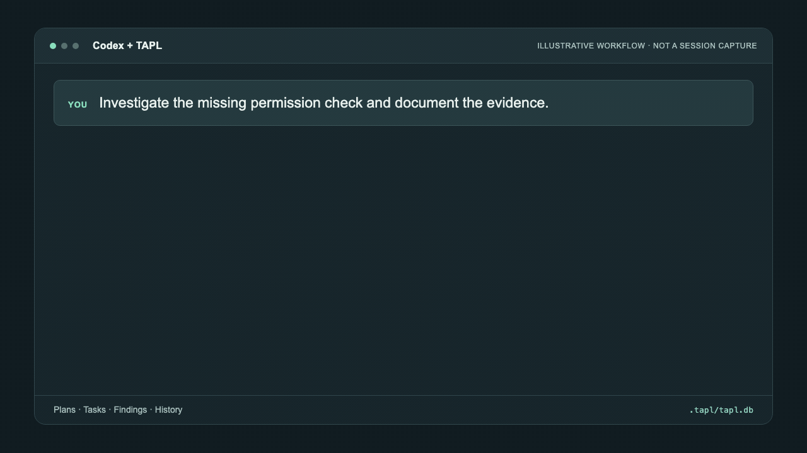
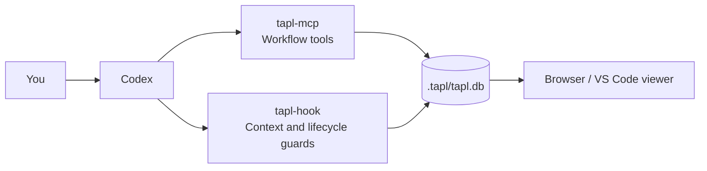

<p align="center">
  
</p>
<h1 align="center">tapl</h1>
<p align="center"><strong>Give your coding agent a memory.</strong></p>
<p align="center">TAPL keeps your Codex plans, approvals, tasks, findings, and history in a SQLite database in the session working folder.</p>
<p align="center"><strong>English</strong> · <a href="README.ko.md">한국어</a></p>
<p align="center">
  <a href="https://github.com/qkdxorjs1002/tapl/releases"></a>
  <a href="docs/getting-started/installation.md"></a>
  <a href="LICENSE.md"></a>
</p>
<p align="center"><a href="#quick-start">Quick start</a> · <a href="#associative-memory">Associative memory</a> · <a href="#workflow">Workflow</a> · <a href="docs/README.md">Documentation</a></p>

## Why TAPL?

Keep asking Codex to work normally. TAPL makes that work visible while it happens
and recoverable when the conversation ends.

- **Resume with context.** Recover the plan, completed tasks, and remaining work in a later session.
- **Keep decisions close to the code.** Each Codex session working folder owns its history in `.tapl/tapl.db`.
- **See what happened.** Inspect approvals, findings, validation, and lifecycle events.
- **Search previous work.** Full-text search is included; semantic search is optional.
- **Recall relevant experience.** Short memory cues point back to earlier work when it becomes useful.
- **Coordinate parallel tasks.** Track dependencies and exclusive file ownership while Codex manages the agents.

<a id="associative-memory"></a>

## Associative memory

“I think we implemented it this way…” can be enough to find the right record.
TAPL's associative memory connects the current task to earlier work through short
cues. The agent follows a cue to its original source and checks whether it applies now.

For example, while revising a migration, a memory about checking transaction
boundaries can lead back to the original implementation and validation results.

1. **Keep useful lessons.** At completion, the agent can save up to two verified decisions, reusable solutions, or pitfalls. Each memory contains a note of at most 240 characters, 3–5 cues, and a reference to its source run or record.
2. **Recall at the right moment.** When a new run is summarized, TAPL adds up to three relevant hints to the context, once per run. The agent checks the linked originals before using them.
3. **Strengthen through actual use.** A memory lasts longer when the agent records that it checked the source and used it in the work. Simply viewing or searching for a memory does not strengthen it.

Unused memories gradually fade, but age alone never deletes them. Recall uses the
existing SQLite database and full-text search, without a separate embedding model
or background service.

The browser and VS Code Viewer offer read-only memory lists, search, details, and
original sources. They also distinguish the total stored count from query matches
and show recent capture failures. Ask the agent explicitly to edit or delete a memory.

At completion, the agent records a capture decision or an explicit skip with a
reason. It inspects the full finish receipt, resolves pending memory errors, and
then archives the run. The work result is saved separately from memory processing.
One or two short sentences are recommended; the 240-character limit, 3–5 cues,
and source reference remain required.

Automatic capture, recall, and reinforcement are enabled by default. To disable
them while keeping manual inspection and management available:

```sh
taplctl config set recall.enabled false
# Restore the default:
taplctl config unset recall.enabled
```

See the [associative memory guide](docs/guides/memory.md) for detailed rules and limits.

<a id="workflow"></a>

## See the workflow

PLAN/TASK authoring detail defaults to `auto`: Fast uses `minimal`, Standard uses `normal`, and Strict uses `precise`.
Choose an explicit level to keep it fixed; record detail has no fixed count or length target.

```sh
taplctl config set workflow.authoring_detail normal
# Restore the default:
taplctl config unset workflow.authoring_detail
```

See the [authoring detail guide](docs/guides/authoring-detail.md) for each level and configuration scope,
and [benchmark results](docs/reference/benchmarks.md) for measured comparisons.

Ask for an outcome, in your own words:

> Investigate the missing permission check and document the evidence.

The example below traces the permission-check call path, records the evidence,
and saves the investigation with its follow-up work.

When one request contains independent topics, Codex keeps one RUN and writes a separate PLAN for each topic before designing TASKs. For example, a request covering these four topics produces:

| PLAN | Topic |
| --- | --- |
| PLAN-001 | Regex filtering for irregular hostnames |
| PLAN-002 | A default Codex CLI environment for analysis |
| PLAN-003 | Model reasoning level settings |
| PLAN-004 | Ad detection through web page elements |

Each PLAN has its own requirements, approach, and validation; each TASK references its topic's PLAN through `spec_id`. Steps, constraints, examples, and tests serving one outcome stay together. Separate RUN lifecycles are used only when explicitly requested.

Multiple Codex sessions in the same working folder can work concurrently in their own RUNs. Each RUN has one owning session; resuming that session continues its RUN. Approvals, TASKs, split queues, Stop, and archiving remain scoped to that owner. The Viewer lets you select an active RUN or explicitly confirm its discard.

Include the Codex hook's `session_id` on every `tapl_*` MCP call. Older clients that omit it can read only the isolated legacy scope, and unidentified writes are rejected once the workspace contains session-owned records. Existing database RUNs remain in the legacy scope; the schema upgrade first saves `.tapl/tapl.db.pre-v14.bak`. New sessions never automatically take ownership of another session's RUN. Workflow state is isolated, while working files remain shared; coordinate simultaneous edits to the same file or use separate worktrees.

<p align="center">
  
</p>

[View the still image](assets/readme/workflow-en.png)

This is an illustrative sequence of public progress messages, not a captured
session. It uses **Investigation · Strict · Planned** for this permission/security
scenario; other requests can take fewer stages. An explicit request to edit or
test already counts as approval for that work.

The durable record follows **RUN → HISTORY → PLAN → TASK → FINDING → ARCHIVE**:
start the work, recover relevant context, record the plan, track execution,
preserve the evidence, and leave a result the next session can use.

<a id="quick-start"></a>

## Quick start

<a id="agent-install"></a>

### Ask your agent to install TAPL

Copy this prompt into your coding agent, such as Codex:

```text
Install TAPL and connect it to Codex.
Repository: https://github.com/qkdxorjs1002/tapl
Installation guide: https://github.com/qkdxorjs1002/tapl/blob/main/docs/getting-started/installation.md

Read the guide, detect my OS and shell, and check prerequisites and any existing installation.
Use the official installation method for my OS and the latest stable release unless I specify another channel.
Before connecting, confirm my preferred scope unless I already specified it: user (all my Codex projects) or repo (only the target repository).
Run taplctl install user or taplctl install repo for the chosen scope, using the guide's platform-specific executable path when needed.
Preserve existing TAPL settings, hook mode, workflow databases, and unrelated Codex settings.
Verify the result with taplctl --version and taplctl doctor.
Report the installed version and any remaining terminal/Codex restart and hook-trust steps.
```

See [connection scopes](#connection-scope) below and [installation options](#installation)
for other platforms or Windows prerelease testing.

### Install with commands

On macOS with Homebrew, install the stable release:

```sh
brew tap qkdxorjs1002/tap
brew trust --formula qkdxorjs1002/tap/taplctl
brew install taplctl
```

<a id="connection-scope"></a>

Then choose **one** Codex connection scope:

| Scope | When to choose it | Command |
| --- | --- | --- |
| User | Use TAPL across your Codex projects | `taplctl install user` |
| Repository | Use TAPL only in the target repository | `taplctl install repo` |

Run the repository command from the target repository, or specify its path with
`taplctl install repo --repo /path/to/repository`.

1. **Restart Codex** to load the TAPL MCP server and lifecycle hooks.
2. **Trust the installed hook** when Codex first asks.
3. **Open your intended working folder and ask normally.** Codex records the work through TAPL.

TAPL creates `.tapl/tapl.db` in the Codex session working folder. A nested folder
gets its own history even when a parent folder already has a TAPL database. You do
not need to write workflow records by hand or learn another set of task-management
commands.

After the first installation, TAPL refreshes existing user/repo integrations at
MCP startup and hook entry. It detects version and shipped-template changes,
preserves your settings, adds new defaults, and migrates known obsolete keys.
You do not need to repeat `taplctl install user` or `taplctl install repo` after
updates. Uninstalled scopes stay disabled, and a missing repo config continues
to inherit user settings. Restart Codex when changed host settings need reloading.

During work, TAPL reports planning, execution, and verification with concise
PLAN/TASK notices alongside the RUN classification.

Using Linux, Windows, or another release channel? Choose an option below and
follow its [Codex connection command](docs/getting-started/integrations.md).

## Installation

You can also use the [Agent installation prompt](#agent-install) above to have
your agent check the environment, install TAPL, connect Codex, and verify setup.
Choose `taplctl install user` for your Codex projects or `taplctl install repo`
for one repository. The prompt confirms this choice before connecting.
See [connection scopes](#connection-scope) and the [platform-specific commands](docs/getting-started/integrations.md).

| Platform / channel | Install option | Details |
| --- | --- | --- |
| Homebrew · stable | `taplctl` | [Full-text search](docs/getting-started/installation.md) |
| Homebrew · stable + semantic | `taplctl-semantic` | [Embedding and vector dependencies](docs/getting-started/installation.md) |
| Homebrew · newest published release | `taplctl-pre` | [May include prereleases](docs/getting-started/installation.md) |
| Linux | Standalone shell installer | [Setup and paths](docs/getting-started/installation.md) |
| Windows 10 / 11 | PowerShell / CMD scripts | [Setup and paths](docs/getting-started/installation.md) |

Windows supports `-Pre`, `-Semantic`, and `-Version TAG`; see the
[channel and semantic options](docs/getting-started/installation.md).

Install only one Homebrew formula at a time; they share the same executables.
Standalone installers default to the latest stable release. See the guide for
[requirements](docs/getting-started/installation.md), [updates](docs/getting-started/installation.md), and
[troubleshooting](docs/guides/troubleshooting.md).

## Open the viewer

The browser and VS Code extension share the same Viewer screens, features, and message types. The browser uses the extension’s neutral default colors; VS Code’s selected theme takes precedence inside the extension.

From the same working folder, start the local viewer:

```sh
taplctl viewer
# tapl viewer: http://127.0.0.1:8000
```

Open **<http://127.0.0.1:8000>** in your browser to inspect runs, plans, tasks,
findings, archives, and associative memories. Memory screens support read-only
list, search, detail, and original-source inspection. Ask the agent explicitly to
edit or delete a memory through MCP. The command does not open a browser automatically;
press `Ctrl+C` to stop it.

The **×** icon on a RUN tab opens a confirmation dialog. Enter or paste the full
RUN ID exactly to confirm. RUNs with records are force-archived with their dependent
work; truly empty RUNs are deleted without an archive. Cancellation changes nothing.
See [RUN discard behavior](docs/guides/viewer.md) for scope and execution details.

Use `taplctl viewer --port 9000` if port 8000 is busy. If no workspace is selected,
the viewer asks for an initialized workspace folder.

For login services, reverse proxies, and the optional VS Code viewer, see
[viewer setup](docs/guides/viewer.md).

## How it works



**`tapl-mcp`** exposes typed workflow tools. **`tapl-hook`** supplies current state
and checks lifecycle boundaries. Both use the same local database as the viewers.

**`taplctl`** manages installation, configuration, diagnostics, updates, and local
services. Workflow records go through MCP; the CLI is not a workflow data API.
TAPL tracks execution ownership and dependencies; the Codex runtime spawns and
manages SubAgents.

## Documentation

- [Documentation home](docs/README.md) — all topics and reading paths
- [Quick start](docs/getting-started/quickstart.md) · [Configuration](docs/guides/configuration.md) · [VS Code](docs/guides/vscode.md)
- [CLI reference](docs/reference/cli.md) · [MCP tool reference](docs/reference/mcp.md)
- [Issues](https://github.com/qkdxorjs1002/tapl/issues) — report a bug or request a feature

## Development

<a id="workflow-policy-delivery"></a>

See [contributing and verification](docs/development/contributing.md) for setup and checks.
[Architecture](docs/development/architecture.md) and the [MCP reference](docs/reference/mcp.md) explain component boundaries and workflow policy delivery.

## License

MIT. See [LICENSE.md](LICENSE.md).
