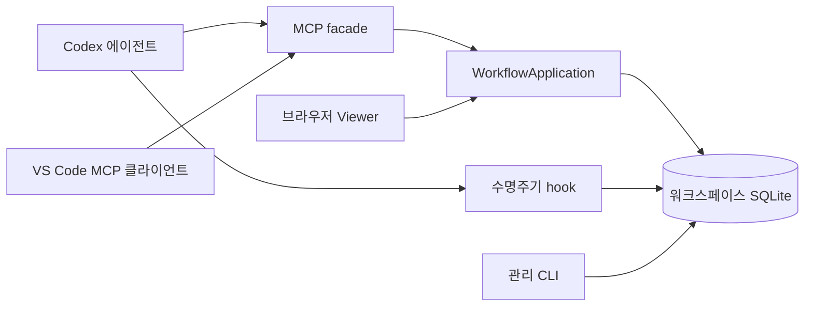

# 아키텍처

[문서 홈](../README.ko.md) · [English](architecture.md)

TAPL은 정확한 작업 폴더의 `.tapl/tapl.db`에 워크플로 상태를 보관합니다. CLI 관리 명령, MCP 워크플로 도구, Codex hook, Viewer는 Python 애플리케이션·DB 경계를 통해 로컬 상태를 사용합니다. 에이전트가 저장소 작업을 수행하고 TAPL은 그 전후의 워크플로를 기록·검증합니다.

## 저장소 구성

| 위치 | 책임 |
| --- | --- |
| `tapl/taplctl/cli.py` | 설치·설정·진단·인덱싱·업데이트·로컬 서비스 명령. |
| `application.py` | 프로세스 내 워크플로 유스케이스, 호출별 연결, 구조화된 기록 병합, 쓰기 검증·응답. |
| `mcp_server.py` | MCP stdio schema·annotation, 세션 라우팅, 비동기 facade, 축약 응답. |
| `db.py` | SQLite schema·마이그레이션, 소유권, 기록, 작업 의존성, 실행 배치, 시간, 아카이브, FTS. |
| `validation.py`, `recommendations.py` | 워크플로 계약 검증과 다음 행동 선택. |
| `prompt.py`, `context.py`, `.codex/` | 정책·bootstrap 문구, 이벤트별 지침, 설치용 hook 템플릿. |
| `hook_cli.py`, `hooks.py`, `sessions.py` | Codex 수명주기 어댑터, 이벤트 검사, 대화 식별자 범위. |
| `config.py`, `config_editor.py` | 적용 설정과 검증된 설정 수정. |
| `embeddings.py`, `searchd.py` | 선택적 의미 검색과 Unix 소켓 임베딩 데몬. |
| `recall.py`, `memory_search.py` | 연상 메모리·원본 연결·revision·검토·캡처·검색. |
| `viewer.py`, `_viewer/` | 브라우저 HTTP 어댑터와 컴파일한 공유 UI. |
| `install.py`, `updater.py`, `uninstall.py`, `command_runtime.py` | 설치 수명주기와 플랫폼 명령·stdio 처리. |
| `vscode-extension/src/` | VS Code 워크스페이스·MCP 어댑터와 공유 React webview. |
| `tapl/tests/`, `vscode-extension/tests/`, `.github/` | 회귀 검증과 빌드·릴리스 자동화. |

접두 경로가 없는 Python 파일은 `tapl/taplctl/` 아래에 있습니다. Python 패키지는 `taplctl`, `tapl-mcp`, `tapl-hook` 진입점을 선언합니다. 공개 인터페이스는 [CLI](../reference/cli.ko.md)와 [MCP](../reference/mcp.ko.md)를 보세요.

## 애플리케이션과 저장 흐름

`WorkflowApplication`은 공개 호출마다 SQLite 연결을 소유합니다. MCP·브라우저 어댑터는 CLI 자식 프로세스를 호출하지 않고 Python을 직접 호출합니다. Native Viewer 읽기도 프로세스 내 DB·애플리케이션 구성 요소를 사용합니다. 확장은 워크스페이스별 MCP 자식 프로세스를 유지하며 해당 폴더를 `cwd`로 실행합니다.

일반 쓰기는 워크스페이스·세션을 정하고 필요한 활성 RUN·실행 승인을 확인한 뒤 구조화된 필드를 병합합니다. 원자적 DB 변경 후 현재 다음 행동을 반환합니다. 계획·작업 Markdown은 표준 필드와 사용자 메타데이터로 생성하며 기록 변경 시 검색 텍스트를 갱신합니다. 모델·출처가 제공한 텍스트는 데이터이며 워크플로 정책을 대신하지 않습니다.

SQLite는 외래 키, WAL, busy timeout을 사용합니다. 소유권에 민감한 생성·dispatch·정리·복구·폐기는 트랜잭션 경계를 사용하고 dispatch는 `BEGIN IMMEDIATE`로 부분 배치를 방지합니다. `status_payload`는 일관된 스냅샷 하나를 읽으며 검증·권고도 서로 다른 조회를 모으지 않고 그 스냅샷을 사용합니다.

Schema는 RUN, 공통 항목, 계획·작업·발견 필드, 승인, 아카이브, 이벤트, 의존성, 실행 배치, 작업 실행, 시간, 임베딩 작업, 메모리를 저장합니다. FTS5는 기록 텍스트와 메모리 cue·note를 인덱싱합니다. 숫자 item ID는 저장된 항목을, 안정된 PLAN·TASK ID는 RUN 안의 항목을 가리킵니다. 아카이브는 이후 검색·조회할 근거를 보존합니다.

## 세션과 실행 소유권

DB는 부모에서 추론한 Git 루트가 아닌 작업 폴더에 속합니다. `find_repo_root`는 전달된 폴더나 현재 폴더만 해석하므로 초기화한 하위 디렉터리는 독립된 이력을 가질 수 있습니다.

`sessions.py`는 hook `session_id`를 정규화하고 문맥 범위를 제공합니다. `WorkflowConnection`은 연결별 소유자를 유지하며 unique index로 세션마다 활성 RUN 하나를 보장합니다. 식별자를 생략하면 legacy `""`를 선택하며 다른 세션의 RUN을 채택하지 않습니다. Viewer는 활성 소유자 목록을 보여 줄 수 있지만 변경은 올바른 소유자를 명시적으로 선택해야 합니다.

실행 소유권은 영속 배치·실행 기록과 정확한 `execution_id` 검사를 사용합니다. 이 토큰은 취소·복구 후 오래된 에이전트의 정리를 방지합니다. 시간 기반 lease는 아니며 별도 lease 데몬·heartbeat·자동 TTL 만료는 없습니다. Root는 dispatch 선택을 기록하고 에이전트를 생성하며 TAPL 상태 정리를 혼자 담당합니다. `owned_paths`와 완료된 의존성은 배치 계약이며 OS 파일 잠금은 아닙니다.

일반 완료는 결과 저장, 해당 메모리 검토 해결, 별도 아카이브 순서입니다. 확인된 Viewer 폐기는 별도 원자적 경로로 보존할 기록을 남기고 정말 빈 RUN만 삭제하며 DB 실행을 취소합니다. 외부 프로세스는 유지합니다. [워크플로](../concepts/workflow.ko.md), [SubAgent](../guides/subagents.ko.md), [Viewer](../guides/viewer.ko.md)를 참고하세요.

## 정책 전달과 hook 경계

MCP 초기화는 짧은 bootstrap을 전달합니다. `tapl_get_next`는 일반 진입 한 번으로 권위 있는 정책·위임 지침·설정과 최신 `state_summary`·권고를 제공합니다. 호출자가 전체 내용을 보존할 때만 일치하는 `known_policy_revision`으로 정책을 생략할 수 있습니다. 상태를 캐시하거나 승인을 대체하지 않습니다. 모델 목록 완전성 확인은 명시적 설정 작업입니다. 축약 item 응답도 복원할 수 없는 내용을 보존하며 축약 검증도 차단 오류를 모두 유지합니다. 정확한 인자와 내용 보존 규칙은 [MCP 진입 계약](../reference/mcp.ko.md#진입조회설정)에 있습니다.

Hook은 `SessionStart`, `UserPromptSubmit`, `PreToolUse`, `PostToolUse`, `Stop`을 처리합니다. UserPromptSubmit은 세션 소유 RUN을 보장합니다. PreToolUse는 영속 작업의 계획·작업·승인을 검사합니다. PostToolUse는 외부 조사 후 판단에 필요한 발견 기록을 안내합니다. Stop은 미완료 작업·배치·검증·아카이브 가능 여부를 확인합니다. `observe`은 안내하고 `enforce`는 관련 경계를 차단할 수 있습니다. Hook은 이벤트를 기록하고 참조한 지침만 렌더링하며 설정을 캐시하지 않습니다. Stop 이벤트 때문에 진입 조회를 반복할 필요는 없습니다.

Hook은 호스트 수명주기 경계이고 MCP는 구조화된 워크플로 인터페이스입니다. 둘 다 임의의 외부 에이전트를 종료하거나 OS 파일시스템 sandbox를 강제하지 않습니다. 호스트 권한 제어는 별도입니다.

## 검색과 메모리 경계

BM25/전문 검색에는 선택적 의미 검색 의존성이 필요하지 않습니다. `embeddings.py`는 설정된 BM25·semantic·hybrid 검색을 지원하며 의미 검색을 사용할 수 없으면 fallback 사유와 함께 BM25를 반환할 수 있습니다. Semantic extra에는 NumPy, sentence-transformers, sqlite-vec가 있습니다. `searchd`는 Unix 소켓 뒤에 임베딩 모델을 유지하며 Windows에서는 사용할 수 없습니다. Windows도 로컬 의미 검색은 선택할 수 있습니다.

연상 메모리는 짧은 검증된 교훈, 구체적 단서, 원본 기록 링크를 보관합니다. 자동 회상·캡처·검토 제어와 수동 조회는 구분합니다. 메모리 편집은 `expected_revision`, 종료 시 메모리 처리는 활성 `expected_run_id`를 확인합니다. 원본 근거 검증은 에이전트가 담당합니다. [검색](../guides/search.ko.md)과 [연상 메모리](../guides/memory.ko.md)를 보세요.

## Viewer 경계와 검증

브라우저와 VS Code는 React 구성 요소, CSS, 프로토콜 타입을 공유합니다. 브라우저 HTTP는 origin·콘텐츠·워크스페이스를 검사합니다. VS Code는 pool로 관리하는 stdio 클라이언트를 사용하며 오래된 워크스페이스·화면 이동 결과를 거부합니다. 서버의 지원 기능 표시에 따라 메모리·확인된 폐기를 제공하고 구버전에서도 다른 화면을 유지합니다. 메모리 화면은 읽기 전용입니다.

이 경계를 바꿀 때는 세션 격리, 트랜잭션 상태, 구조화된 schema, 정확한 실행 정리, 공유 UI 동작을 보존해야 합니다. `test_session_mcp.py`, `test_application.py`, `test_context_optimization.py`, `test_search.py`, 메모리·폐기 테스트와 확장 호스트 테스트가 계약을 다룹니다. 명령은 [기여와 검증](contributing.ko.md), 패키징 경계는 [릴리스](releases.ko.md)를 보세요.
