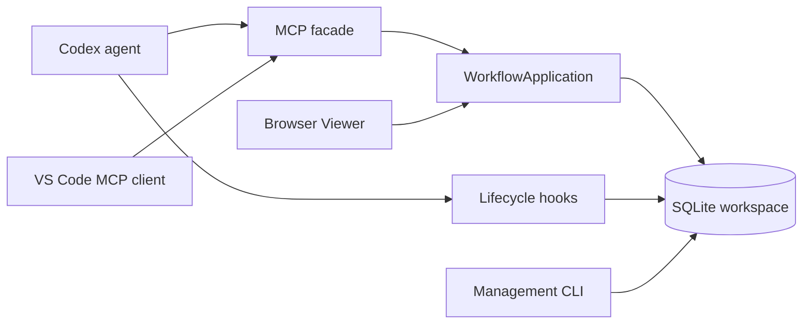

# Architecture

[Documentation](../README.md) · [한국어](architecture.ko.md)

TAPL keeps workflow state in the exact working folder's `.tapl/tapl.db`. CLI management, MCP workflow tools, Codex hooks, and Viewers use that local state through Python application/database boundaries. The agent performs repository work; TAPL records and validates the workflow around it.

## Repository map

| Location | Responsibility |
| --- | --- |
| `tapl/taplctl/cli.py` | Installation, configuration, health, indexing, updates, and local service commands. |
| `application.py` | In-process workflow use cases, per-call connections, typed record merge, write validation, and receipts. |
| `mcp_server.py` | MCP stdio schemas/annotations, session routing, async facade, compact responses. |
| `db.py` | SQLite schema/migrations, ownership, records, task dependencies, execution batches, timing, archives, FTS. |
| `validation.py`, `recommendations.py` | Workflow contract checks and next-action selection. |
| `prompt.py`, `context.py`, `.codex/` | Policy/bootstrap text, event-specific guidance, and installable hook templates. |
| `hook_cli.py`, `hooks.py`, `sessions.py` | Codex lifecycle adapter, event checks, and scoped conversation identity. |
| `config.py`, `config_editor.py` | Effective settings and validated configuration edits. |
| `embeddings.py`, `searchd.py` | Optional semantic retrieval and Unix-socket embedding daemon. |
| `recall.py`, `memory_search.py` | Associative memories, source links, revisions, review/capture, and retrieval. |
| `viewer.py`, `_viewer/` | Browser HTTP adapter and compiled shared UI. |
| `install.py`, `updater.py`, `uninstall.py`, `command_runtime.py` | Installation lifecycle and platform command/stdio handling. |
| `vscode-extension/src/` | VS Code workspace/MCP adapters and shared React webview. |
| `tapl/tests/`, `vscode-extension/tests/`, `.github/` | Regression checks and build/release automation. |

Python filenames without a prefix above are under `tapl/taplctl/`. The Python package declares `taplctl`, `tapl-mcp`, and `tapl-hook` entry points. See [CLI](../reference/cli.md) and [MCP](../reference/mcp.md) for public interfaces.

## Application and storage flow

`WorkflowApplication` owns a SQLite connection per public call; MCP and browser adapters call Python directly rather than invoking the CLI in a subprocess. Native Viewer reads also use in-process database/application components. The extension keeps a workspace-scoped MCP subprocess, launched with that folder as `cwd`.

A normal write resolves the workspace and session, checks the active RUN and execution authorization where required, merges structured fields, performs an atomic database mutation, and returns current next actions. Plan/task Markdown is derived from canonical fields and custom metadata. Searchable text is refreshed with record changes. Model-generated or source-provided text remains data; records do not replace workflow policy.

SQLite enables foreign keys, WAL, and a busy timeout. Ownership-sensitive creation, dispatch, settlement, recovery, and discard use transaction boundaries; dispatch uses `BEGIN IMMEDIATE` to prevent partial batches. `status_payload` reads one consistent snapshot, and state validation/recommendations operate on that snapshot rather than collecting unrelated reads.

The schema stores RUNs, common items, plan/task/finding fields, approvals, archives, events, dependencies, execution batches, task executions, timing, embedding jobs, and memories. FTS5 indexes record text and memory cues/notes. Numeric item IDs identify stored records; stable PLAN/TASK IDs are scoped to a RUN. Archives retain workflow evidence for search and later inspection.

## Session and execution ownership

The database belongs to a working folder, not a Git root inferred from parents. `find_repo_root` resolves only the supplied/current folder. Each initialized subdirectory can therefore own independent history.

`sessions.py` normalizes a hook `session_id` and provides context-local scope; `WorkflowConnection` retains the owner on each connection. A unique index permits one active RUN per session. Omitted identity routes to legacy `""`; it does not adopt another session's RUN. Viewers can list active owners but must explicitly select the correct owner for mutation.

Execution ownership uses persisted batch/execution records and exact `execution_id` checks. These tokens protect settlement against stale agents after cancellation/recovery. They are not time-based leases: there is no separate lease daemon, heartbeat, or automatic TTL expiry. Root records the dispatch selection, spawns the agents, and alone settles TAPL state. `owned_paths` and completed dependencies define the batch contract, not an operating-system file lock.

Normal completion saves the result, resolves applicable memory review, then archives separately. Confirmed Viewer discard is a separate atomic path: preserve retained work, delete only truly empty RUNs, cancel database executions, and leave external processes running. See [Workflow](../concepts/workflow.md), [SubAgents](../guides/subagents.md), and [Viewer](../guides/viewer.md).

## Policy delivery and hook boundaries

MCP initialization sends a short bootstrap. `tapl_get_next` supplies authoritative policy, delegation guidance, config, fresh `state_summary`, and recommendations on one ordinary entry call. Matching `known_policy_revision` may omit policy only when the caller retains its full content. It never caches state or substitutes for approval. Catalog completeness is an explicit setup/settings operation. Compact item responses preserve unreconstructible content, and compact validation keeps all blocking errors. Exact arguments and retention rules live in [MCP entry contract](../reference/mcp.md#entry-inspection-and-setup).

Hooks handle `SessionStart`, `UserPromptSubmit`, `PreToolUse`, `PostToolUse`, and `Stop`. UserPromptSubmit ensures a session-owned RUN. PreToolUse checks durable work for plan/task/approval validity. PostToolUse prompts for decision-relevant findings after external research. Stop checks unfinished work, batches, validation, and archive eligibility. `observe` provides guidance; `enforce` can block the relevant boundary. Hooks record events and render only referenced guidance, without caching settings. A Stop event does not require another entry read.

A hook is a host lifecycle boundary, while MCP is the typed workflow interface. Neither can terminate arbitrary external agents or enforce an OS filesystem sandbox. Host permission controls remain separate.

## Search and memory boundaries

BM25/full-text search works without optional semantic dependencies. `embeddings.py` supports configured BM25, semantic, and hybrid retrieval; semantic unavailability can return BM25 with a fallback reason. Semantic extras include NumPy, sentence-transformers, and sqlite-vec. `searchd` can hold the embedding model behind a Unix socket and is unavailable on Windows; local semantic search remains an option there.

Associative memory stores short verified lessons with concrete cues and links to original records. Automatic recall/capture/review is controlled separately from manual inspection. A memory edit checks `expected_revision`; finish-time memory processing checks the active `expected_run_id`. Original-source verification belongs to the agent. See [Search](../guides/search.md) and [Associative memory](../guides/memory.md).

## Viewer boundaries and validation

Browser and VS Code share React components, CSS, and protocol types. Browser HTTP requests have origin/content/workspace checks; VS Code routes through a pooled stdio client and rejects stale workspace/navigation results. Advertised server capabilities enable memory and confirmed discard while preserving other screens with older servers. Memory screens are read-only.

Changes across these boundaries should preserve session isolation, transactional state, typed schemas, exact execution settlement, and shared UI behavior. `test_session_mcp.py`, `test_application.py`, `test_context_optimization.py`, `test_search.py`, memory/discard tests, and extension host tests cover those contracts. [Contributing](contributing.md) gives commands; [Releases](releases.md) explains packaging boundaries.
