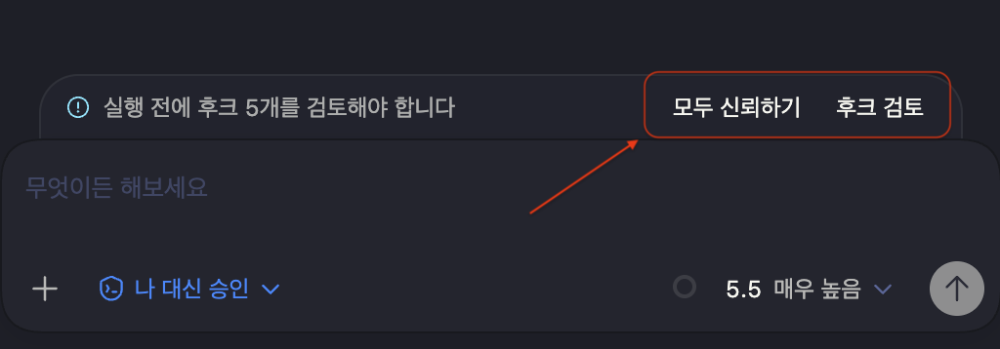

# TAPL 설치·운영 가이드

[README로 돌아가기](../README.ko.md) · [English guide](guide.md)

[필수 환경](#requirements) · [Homebrew](#homebrew) · [Linux](#linux) · [Windows](#windows) · [Codex 연결](#connect) · [Viewer](#viewer) · [설정](#configuration) · [SubAgent](#subagents) · [문제 해결](#troubleshooting)

<a id="requirements"></a>

## 필수 환경

- `venv` 모듈을 포함한 Python 3.11 이상. Homebrew는 `python@3.12`를 사용합니다.
- FTS5와 확장 로딩을 지원하는 SQLite.
- formula 설치에는 Homebrew, 소스 개발에는 `uv`.
- Windows 설치 스크립트에는 Windows PowerShell 5.1 이상 또는 PowerShell 7.
- `taplctl viewer`에는 웹 브라우저, 선택 확장 기능에는 VS Code.

TAPL의 릴리즈 wheel은 플랫폼에 독립적이지만, Python 의존성에는 호환되는 wheel이 필요합니다. 드문 아키텍처, 새로 출시된 Python, Alpine 같은 musl Linux에서는 로컬 빌드 도구가 필요할 수 있습니다.

<a id="homebrew"></a>

## Homebrew

먼저 tap을 추가한 뒤 필요한 채널 **하나만** 설치하세요. 세 formula는 같은 실행 파일을 설치하므로 함께 설치할 수 없습니다. 채널을 바꿀 때는 기존 formula를 먼저 제거하세요.

```sh
brew tap qkdxorjs1002/tap

# 안정판: SQLite 전문 검색
brew trust --formula qkdxorjs1002/tap/taplctl
brew install taplctl
```

```sh
# 안정판: 시맨틱 검색 의존성 포함
brew trust --formula qkdxorjs1002/tap/taplctl-semantic
brew install taplctl-semantic
```

```sh
# 프리릴리즈를 포함해 가장 최근에 공개된 릴리즈
brew trust --formula qkdxorjs1002/tap/taplctl-pre
brew install taplctl-pre
```

`taplctl-pre`에는 `taplctl@pre` 별칭도 있습니다. 이 가이드에서는 정식 formula 이름을 사용합니다. `taplctl`과 `taplctl-semantic`은 안정판만 따릅니다.

Homebrew는 릴리즈에 포함된 wheel 묶음의 고정 의존성을 설치하며, 설치 중 PyPI에서 패키지를 해석하지 않습니다. 현재 formula는 `taplctl`, `tapl-mcp`, `tapl-hook`을 모두 연결하므로 실행 경로를 따로 지정할 필요가 없습니다.

formula를 업그레이드하거나 재설치하면 해당 TAPL viewer 서비스가 이미 실행 중일 때만 자동 재시작을 시도합니다. 중지된 서비스와 신규 설치는 중지 상태로 유지됩니다. 직접 실행한 `searchd`나 MCP stdio 프로세스에는 적용되지 않습니다.

설치 후 [Codex 연결 범위](#connect)를 선택하세요.

<a id="linux"></a>

## Linux 독립형 설치

```sh
curl -fsSL https://raw.githubusercontent.com/qkdxorjs1002/tapl/main/install.sh | sh
```

installer에는 `curl`, Python 3.11+와 `venv`, 쓰기 가능한 install directory가 필요합니다. 기본값은 `${XDG_DATA_HOME:-$HOME/.local/share}/tapl`과 `${XDG_BIN_HOME:-$HOME/.local/bin}`입니다. 해당 XDG 변수 또는 `TAPL_INSTALL_ROOT`, `TAPL_BIN_DIR`로 바꿀 수 있습니다.

shell startup file이나 Codex hook은 수정하지 않습니다. 출력된 `PATH` export를 적용하고 필요하면 영구적으로 설정한 뒤, 아래에서 TAPL을 Codex에 연결하세요.

<a id="windows"></a>

## Windows 독립형 설치

```powershell
Invoke-WebRequest -UseBasicParsing https://raw.githubusercontent.com/qkdxorjs1002/tapl/main/install.ps1 -OutFile install.ps1
powershell.exe -NoProfile -ExecutionPolicy Bypass -File .\install.ps1
```

Windows 10/11, `venv`가 포함된 Python 3.11 이상, PowerShell 5.1 이상이 필요합니다.
관리자 권한 없이 현재 사용자에게 최신 안정판을 설치합니다.
고정 주소의 진입 스크립트가 선택한 릴리즈의 설치 스크립트를 내려받아 실행합니다.

기본 경로는 `%LOCALAPPDATA%\tapl`입니다. 사용자 `PATH`가 적용되도록 터미널을
다시 열고 [TAPL을 Codex에 연결](#connect)하세요.

<details>
<summary>명령 프롬프트(CMD)에서 설치</summary>

쓰기 가능한 폴더에 CMD 스크립트 하나를 내려받아 실행하세요.

```bat
curl.exe -fL https://raw.githubusercontent.com/qkdxorjs1002/tapl/main/install.cmd -o install.cmd
install.cmd
```

설치 뒤 CMD를 다시 열고 [Codex 연결 범위](#connect)를 선택하세요.

</details>

<a id="windows-prerelease"></a>
<a id="2140-beta1-프리릴리즈-테스트"></a>

<details>
<summary>릴리즈 채널과 시맨틱 검색 옵션</summary>

내려받은 진입 스크립트는 PowerShell과 CMD에서 같은 옵션을 받습니다.

| 옵션 | 설치 대상 |
| --- | --- |
| 없음 | 최신 안정판 |
| `-Pre` | 프리릴리즈를 포함한 가장 최근 게시 릴리즈. 더 최신인 안정판을 선택할 수도 있음 |
| `-Semantic` | 최신 안정판과 임베딩·벡터 의존성 |
| `-Pre -Semantic` | 가장 최근 게시 릴리즈와 시맨틱 의존성 |
| `-Version TAG` | 지정한 릴리즈. `TAG`를 원하는 릴리즈 태그로 변경 |

`-Semantic`은 `-Version TAG`와 함께 사용할 수 있습니다. `-Pre`와 `-Version`은 함께 사용할 수 없습니다.
특정 버전은 사용하는 셸에 맞춰 실행하세요.

```powershell
powershell.exe -NoProfile -ExecutionPolicy Bypass -File .\install.ps1 -Version TAG
```

```bat
install.cmd -Version TAG
```

각 릴리즈의 설치 파일은 자신의 버전만 설치합니다. 고정 주소의 진입 스크립트가
릴리즈를 선택한 뒤 해당 릴리즈의 설치 스크립트를 실행합니다.

</details>

<details>
<summary>업데이트·재설치·제거와 경로 변경</summary>

업데이트를 확인한 뒤 새 버전을 설치합니다.

```powershell
taplctl update --check
taplctl update
```

재설치와 실행 파일 제거에는 내려받은 설치 스크립트를 사용합니다. 제거 전에는
설치했던 범위의 연결을 해제하세요. 사용자 범위는 `taplctl uninstall user`,
저장소 범위는 연결했던 각 저장소에서 `taplctl uninstall repo`를 실행합니다.
아래에서 사용하는 셸의 명령을 선택하세요.

| 작업 | PowerShell | CMD |
| --- | --- | --- |
| 재설치 | `powershell.exe -NoProfile -ExecutionPolicy Bypass -File .\install.ps1 -Reinstall` | `install.cmd -Reinstall` |
| 실행 파일 제거 | `powershell.exe -NoProfile -ExecutionPolicy Bypass -File .\install.ps1 -Uninstall` | `install.cmd -Uninstall` |

업데이트·재설치 뒤에는 [사용 중인 범위를 다시 연결](#connect)하고 기존
`observe`/`enforce` 모드를 유지한 뒤 Codex를 재시작하세요.

제거해도 설정·워크플로 DB·무관한 파일은 보존합니다. 파일 목록이 없는 구형 설치는
먼저 `-Reinstall`이 필요합니다. 관리 대상 파일이 변경되면 제거를 중단합니다.

`TAPL_INSTALL_ROOT`와 `TAPL_BIN_DIR`로 설치·launcher 경로를 바꿀 수 있습니다.
기본 launcher는 `%LOCALAPPDATA%\tapl\bin\taplctl.cmd`입니다.
업데이트는 선택한 안정판·프리릴리즈·고정 버전 채널과 시맨틱 옵션을 유지합니다.
다른 버전으로 바꾸거나 낮추려면 진입 스크립트에 `-Version TAG`를 지정하세요.
`TAPL_INSTALL_MANIFEST_URL`로 별도 manifest를 선택할 수 있지만, 릴리즈 설치 파일은
자신의 버전만 허용합니다. 설치 전 manifest와 wheel SHA-256을 검증합니다.

</details>

<a id="connect"></a>

## TAPL을 Codex에 연결

TAPL 설치 후 Codex 연결 범위를 **하나 선택**하세요.

| 범위 | 적용 대상 | 명령 |
| --- | --- | --- |
| 사용자 | `~/.codex` 사용자 설정을 통해 내 Codex 프로젝트 전체 | `taplctl install user` |
| 저장소 | 대상 저장소의 로컬 `.codex` 설정을 통해 해당 저장소만 | `taplctl install repo` |

`repo`는 대상 저장소 디렉터리에서 실행하거나
`taplctl install repo --repo /path/to/repository`로 경로를 지정하세요.
저장소 설치는 로컬 `.tapl` 설정과 워크플로 DB도 만듭니다.
연결 범위는 패키지 설치 방법이나 릴리즈 채널과 별개로 선택합니다.

Homebrew의 세 formula 모두 위에서 선택한 명령으로 연결합니다.

설치 프로그램이 `PATH`에서 `taplctl`을 찾고 같은 디렉터리의 `tapl-mcp`와
`tapl-hook`을 사용합니다. 일반적인 Homebrew 설치에서는 경로 옵션이 필요하지 않습니다.

<details>
<summary>선택 사항: 특정 설치본 지정</summary>

자동 탐색이 다른 실행 파일을 선택하거나 특정 설치본을 지정해야 할 때만
`--taplctl-command`를 사용하세요. 예를 들면 다음과 같습니다.

```sh
# 연결 범위를 하나 선택:
taplctl install user --taplctl-command "$(brew --prefix taplctl)/libexec/bin/taplctl"
# 또는 대상 저장소에서:
taplctl install repo --taplctl-command "$(brew --prefix taplctl)/libexec/bin/taplctl"
```

`taplctl-semantic`이나 `taplctl-pre`를 설치했다면 formula 이름을 바꾸세요.
지정한 실행 파일을 기준으로 해당 설치본의 MCP와 hook 경로를 찾습니다.

</details>

독립형 설치는 아래처럼 실제 `taplctl` 실행 파일을 지정합니다. 독립형 설치 스크립트의 기본 채널은 최신 안정판입니다.

Linux 독립형 설치:

```sh
# 연결 범위를 하나 선택:
taplctl install user --taplctl-command "$(realpath "$(command -v taplctl)")"
# 또는 대상 저장소에서:
taplctl install repo --taplctl-command "$(realpath "$(command -v taplctl)")"
```

Windows 독립형 설치:

```powershell
$taplRoot = if ($env:TAPL_INSTALL_ROOT) { $env:TAPL_INSTALL_ROOT } else { Join-Path $env:LOCALAPPDATA "tapl" }
$taplInstall = Get-Content -Raw (Join-Path $taplRoot "install.json") | ConvertFrom-Json
# 연결 범위를 하나 선택:
taplctl install user --taplctl-command (Join-Path $taplInstall.venv "Scripts\taplctl.exe")
# 또는 대상 저장소에서:
taplctl install repo --taplctl-command (Join-Path $taplInstall.venv "Scripts\taplctl.exe")
```

선택한 범위의 명령 하나만 실행하세요.

사용자 설치에서는 Codex가 세션 작업 폴더의 TAPL DB를 초기화하며, 로컬
`.tapl/config.toml`과 `.tapl/version`은 생성하지 않습니다. 저장소 자동 갱신에는
기존 DB와 `.tapl/version`이 필요하며, 남아 있는 훅이나 로컬 설정만으로 설치를
시작하지 않습니다. 로컬 설정이 없으면 사용자 설정 또는 기본값을 계속 사용합니다.
누락된 저장소 설치 파일을 복원하려면 `taplctl install repo`를 명시적으로 실행하세요.
설치 프로그램은 예전 TAPL MCP `cwd` 재정의도 제거하여 오래된 고정 작업 폴더가
서버를 다른 작업 공간에 묶어 두지 않도록 합니다.

이 명령은 `tapl-mcp`를 위한 활성화된 `mcp_servers.tapl` entry와 `tapl-hook` Codex
lifecycle hook을 추가합니다. 이후 Codex를 재시작하세요. Codex가 처음 확인을 요청하면
설치된 hook을 신뢰합니다.

<p align="center">
  
</p>

<a id="viewer"></a>

## Viewer 열기

초기화된 작업 공간에서 실행합니다.

```sh
taplctl viewer
# tapl viewer: http://127.0.0.1:8000

taplctl viewer --port 9000  # 8000 포트가 사용 중일 때
```

viewer는 `127.0.0.1`에서만 수신하고 브라우저를 자동으로 열지 않으며 `Ctrl+C`로
종료합니다. `--workspace`를 지정하지 않으면 시작한 폴더의 `.tapl/tapl.db`만
선택하고 상위 폴더는 검색하지 않습니다. Homebrew 로그인 서비스처럼 시작한
폴더에 DB가 없으면 초기화된 작업 공간 폴더를 선택하는 화면이 나타납니다.
브라우저는 마지막으로 연결에 성공한 폴더를 기억합니다.

<a id="discard-run"></a>

### RUN 폐기

RUN 탭의 **×** 아이콘을 누르고 확인창에 표시된 전체 RUN ID를 입력하거나 붙여넣으세요.
대소문자와 공백까지 정확히 일치해야 확인 버튼이 활성화됩니다. 취소하거나 Escape를
누르면 RUN을 변경하지 않습니다.

확인하면 해당 RUN의 계획·작업·발견사항 등 기록과 같은 소유자의 분할 요청에 속한
대기 RUN을 강제 아카이브합니다. DB의 진행 중 실행·배치는 취소 상태로 바꾸고 작업
시간 측정을 중지하며 다음 RUN을 자동 시작하지 않습니다. 진짜 빈 RUN은 아카이브 없이
삭제합니다. 결과·실행 이력·기억·보존할 참조가 있으면 기록이 있는 RUN으로 취급합니다.
다른 세션과 무관한 요청은 유지합니다. 이 처리는 워크플로 상태만 정리하며 외부에서
실행 중인 Agent 프로세스 자체를 종료하지 않습니다.

### 리버스 프록시와 터널

다른 주소로 viewer를 제공하려면 브라우저가 접근하는 정확한 origin을 허용하세요.

```sh
taplctl viewer --allowed-origin https://tapl.example.com
```

서비스에 지속해서 적용하려면 `~/.tapl/config.toml`에 저장하고 설치한 formula의 서비스를 재시작합니다.

```toml
[viewer]
allowed_origins = ["https://tapl.example.com", "https://tapl.internal.example"]
```

```sh
brew services restart taplctl
```

origin은 HTTP(S) 스킴, 호스트, 선택적인 포트만 포함합니다. 여러 origin은 `--allowed-origin`을 반복하거나 설정 배열에 추가하세요. CLI와 설정의 origin은 합쳐집니다. TAPL은 계속 loopback에서만 수신하며, 인증과 TLS는 프록시에서 처리합니다. 신뢰할 수 없는 네트워크에 노출할 때는 와일드카드 origin 규칙을 피하세요.

### 서비스와 시맨틱 검색

설치한 Homebrew formula를 login 때 자동 시작하려면 `brew services start taplctl`,
`brew services start taplctl-semantic`, 또는 `brew services start taplctl-pre`를
사용하세요. 모든 service는 8000 포트에서 viewer를 제공합니다.

semantic formula는 preloaded search process를 의도적으로 시작하지 않습니다. 필요하면
`taplctl searchd start`와 `taplctl searchd status`를 실행하세요.

선택 `searchd` daemon은 Unix socket을 사용하므로 Windows에서는 지원하지 않습니다.
Windows에서도 선택 의존성을 설치하면 로컬 semantic search를 사용할 수 있으며,
daemon 없이 BM25/전문 검색을 사용할 수 있습니다.

선택 VS Code extension은 workspace별 persistent `tapl-mcp` client를 사용합니다.
executable을 못 찾으면 `taplWorkflow.taplMcpPath`를 설정하세요.

### 재개와 검색

Codex는 typed MCP tool로 current state, archive detail, history를 읽습니다. SQLite FTS는
모든 설치에서 동작합니다. embedding/vector search에는 semantic extra 또는
`taplctl-semantic` formula를 설치하고, 기존 workspace의 index를 다시 만들 때는
`taplctl reindex`를 사용하세요.

### 병렬 작업

TAPL은 execution manifest를 조율하지만 worker를 spawn하지는 않습니다. Codex/root
runtime이 SubAgent를 만들고 관리합니다. 병렬 executable task는 dependency가 완료되고
서로 겹치지 않는 file 또는 directory를 소유할 때만 유효합니다. `strategy`는 강제 결과가 아니라
판단 bias입니다. agent는 task independence, 필요한 context, risk, coordination cost,
parallel value를 평가한 뒤 root 실행 또는 위임을 선택합니다. 순차 task, 공유 file 또는
state, root 수준의 결정은 main agent가 수행합니다. 사용자 task profile은 반복 작업에
대한 advisory 특성과 순서가 있는 model/effort 선호를 추가할 수 있습니다. 이는 model ID의
영구 역할이 아닌 교체 가능한 preset이며, agent는 이유를 기록하고 profile이나 candidate를
override할 수 있습니다.

범위가 정해진 읽기 전용 파일 탐색이나 조사는 계획 전후에 host SubAgent에 위임할 수
있으며, 이를 위해 task, batch, `owned_paths`를 별도로 만들 필요는 없습니다. workflow
mode 분류 전, 요청 자체로 충분하거나 이미 파악한 범위가 충분하면 scout를 생략합니다.
알려진 대상의 확인 한 번이면 충분할 때는 root가 조회합니다. 저장소의 대상, dependency,
검증 범위가 불명확하면 **자격을 충족하는 읽기 전용 SubAgent 하나**를 우선하며,
중첩 helper는 허용하지 않습니다. root는 요청과 기존 context로 위임 여부를 판단하며,
이를 결정하려고 전체 scout를 먼저 수행하지 않습니다.
이 TAPL 지침은 setup이 완료되고 위임이 활성화된 경우에 적용됩니다.
사용자 선호와 기존 strategy 및 profile을 따르며, 설정된 allowlist와
현재 runtime catalog에 모두 있는 model/effort 조합만 선택합니다.
setup이 pending이거나 위임이 비활성화되었거나 적절한 runtime candidate가 없으면
root가 조회합니다.

helper에게는 요청, 읽기·검색 범위, 남은 조회 한도, 응답 분량 제한, 제약, 중단 조건만 전달하며,
기본적으로 전체 대화 이력을 fork하지 않습니다. source, 설정, 테스트를 우선 살피고
생성 파일, dependency, minified 파일의 대량 출력을 피합니다. `file:line` 근거,
dependency, 필요한 검증, risk와 미확인 사항, 사용한 조회 횟수를 간결하게 보고합니다.

요청 분류 전에는 **root와 helper를 합쳐 대상을 좁힌 local 읽기 전용 조회를 최대 3회**까지
할 수 있습니다. root는 검색을 반복하지 않고 보고를 활용하며, 미해결 모순이나 필수 질문에만
남은 조회 한도를 씁니다. 실패해도 한도는 복구되지 않으며, 사용량이 보고되지 않으면
helper에게 배정한 한도를 모두 사용한 것으로 처리합니다. scout 중에는 root와 helper 모두
수정, 테스트 실행, 외부 조사, history 검색, TAPL 상태 변경을 할 수 없습니다. helper는
부수 효과가 있는 작업이나 workflow 기록 쓰기를 할 수 없으며, 최종 workflow mode 결정,
계획 수립, scout 이후 TAPL 상태 쓰기는 root만 담당합니다. 분류 후 조사는 해당 source와
history 규칙을 따릅니다. 저장되거나 실행 가능한 task에는 아래의 승인, dependency,
소유 범위, dispatch, 정산 요건이 그대로 적용되며, scout는 실행 승인을 우회하지 않습니다.
이는 새 설정이나 database field를 추가하지 않는 지침 정책이며, 지연 시간이나 전체 token
사용량 절감을 보장하지 않습니다.

## 워크플로와 관리 명령

`tapl-mcp`는 워크플로 애플리케이션을 직접 호출합니다. `tapl-hook`은 Codex의 수명 주기 지점에서 현재 상태를 전달하고, 실행 승인 전에 지속되는 변경이 일어나지 않도록 확인합니다. 두 구성 요소와 viewer는 선택한 작업 폴더의 `.tapl/tapl.db`를 사용합니다.

실행 전 승인은 필요하지만 **수정·테스트·구현·검증을 직접 요청한 것 자체도 명시적인 실행 승인**입니다. 매 요청마다 별도 승인 질문이 필요한 것은 아닙니다. 작업의 범위와 위험에 따라 흐름을 분류하며, 간단한 읽기 전용 요청은 계획과 작업을 만들지 않는 가벼운 기록으로 끝날 수 있습니다.

`taplctl`은 설치와 관리용입니다. 공개 명령은 `init`, `doctor`, `update`, `install`, `uninstall`, `config`, `viewer`, `reindex`, `searchd`의 아홉 가지입니다. 워크플로 기록 생성·조회·검색과 작업 실행 상태 관리는 에이전트가 MCP 도구로 수행합니다.

### 기록 작성 지침

MCP 필드의 자연어 값은 사람이 읽는 설명문입니다. 계획·작업 본문과 custom field의
설명도 사용자 언어의 정상적인 문장과 띄어쓰기로 작성합니다. 간결하게 쓰려면 반복을
줄이고, 한국어 단어를 붙여 쓰는 방식으로 압축하지 않습니다. 기존 기록을 재사용할 때도
압축된 문체를 그대로 복사하지 않고 읽기 쉬운 설명문으로 작성합니다. 식별자·경로·명령과
직접 인용한 원문은 그대로 보존합니다.

다음은 문체 예시이며, 추가 작업 요구사항은 아닙니다.

- `objective`: 개발 앱 설정을 준비한 뒤 Task 1개를 실행하고 결과를 확인한다.
- `action`: APP_CONFIG_YML 경로를 확인하고 검증 결과를 기록한다.

전체 MCP 정책에 이 예시와 typed field·Markdown·계획 서식 지침이 함께 전달되며,
자연어 필드 설명에도 짧은 가독성 안내가 포함됩니다. 이는 Agent의 작성 지침입니다.
띄어쓰기를 기준으로 한 런타임 경고·입력 거부·자동 보정이나 과거 기록의 일괄 수정은
추가하지 않습니다.

## 설치 관리

| 명령 | 용도 |
| --- | --- |
| `taplctl init --workspace-root /path/to/workspace` | 지정한 폴더의 workspace를 명시적으로 초기화 |
| `taplctl doctor` | 설치와 workspace 문제 진단 |
| `taplctl install SCOPE` | Codex integration 설치 또는 갱신 |
| `taplctl uninstall SCOPE` | Codex 연결 해제, 기본적으로 설정과 데이터 보존 |
| `taplctl config set/unset` | 지원 runtime config 값 편집 |
| `taplctl viewer [--port 9000]` | local browser viewer 열기 |
| `taplctl update --check` / `update` | 독립형 설치 업데이트 확인 또는 실행 |
| `taplctl reindex` | search index 다시 만들기 |
| `taplctl searchd start` / `status` | 선택 semantic search process 관리 |

<a id="updates"></a>

### 업데이트

Linux와 Windows 독립형 설치:

```sh
taplctl update --check
taplctl update
```

updater는 release manifest와 wheel SHA-256을 검증합니다. Homebrew와 source checkout은
업데이트하지 않습니다. Homebrew라면 설치한 formula에 맞춰 `brew update` 후
`brew upgrade taplctl`, `brew upgrade taplctl-semantic`, 또는 `brew upgrade taplctl-pre`를
사용하세요.

<a id="configuration"></a>

## 작업 공간과 설정

Codex 세션에서는 작업 폴더 자체가 `.tapl/tapl.db`를 소유합니다. hook은 Codex
이벤트에 존재하는 절대 경로 `cwd`를 요구하고 정확히 그 폴더를 사용합니다. `cwd`가
없거나 유효하지 않으면 다른 경로로 대체하지 않고 거부합니다. hook의 `--db`는 그
폴더의 DB를 지정할 때만 허용합니다. MCP 서버는 시작할 때의 작업 폴더를 서버가
살아 있는 동안 계속 사용합니다. 상위 DB, Git root, 저장소 표시 파일은 검색하지
않습니다. 예를 들어 `repo/.tapl/tapl.db`가 있어도 `repo/packages/app` 세션은
`repo/packages/app/.tapl/tapl.db`를 사용합니다.

각 폴더의 이력은 독립적입니다. 기존 DB는 그대로 두며 이동하거나 합치지 않습니다.
원하는 이력의 폴더에서 Codex를 여세요. 관리용 `taplctl` 명령은 명시적 `--db`,
`--workspace-root` 옵션으로 지정한 경로를 계속 사용할 수 있습니다.

TAPL은 작업 폴더의 `.tapl/config.toml`을 먼저 읽고, 없으면
`~/.tapl/config.toml`을 읽습니다. 상위 폴더의 project config는 검색하지 않습니다.
작업 폴더에 로컬 설정이 없어도 사용자 전체 설정은 계속 적용됩니다.

installation은 관련 없는 Codex setting을 보존합니다. `hooks.json`은 managed merge되고,
`.codex/config.toml`은 기존 user value를 우선하는 TOML merge입니다. runtime config는 첫
install에 생성됩니다. upgrade 때 default overwrite 또는 누락 key merge를 물을 수
있습니다. TAPL managed template value를 우선하려면 `--force`를, runtime config policy를
명시하려면 `--tapl-config-policy {prompt,overwrite,merge}`를 사용하세요.

TOML을 직접 편집하지 않고 runtime 값을 바꿀 수 있습니다.

```sh
taplctl config set search.mode hybrid
taplctl config set search.max_results 20
taplctl config set viewer.allowed_origins '["https://tapl.example.com"]'
taplctl config set subagents.strategy balanced
taplctl config unset search.mode
```

`set`은 점 표기 `KEY`와 `VALUE` 하나를 받습니다. 값은 TOML 문법을 사용하며 enum 문자열은
따옴표 없이 전달할 수 있습니다. 배열은 위 예시처럼 보통 shell에서 따옴표로 감싸세요.
`unset`은 `KEY`만 받고 해당 값을 제거해 내장 기본값을 복원합니다. 두 명령 모두 변경 후의
전체 config를 검증하며 주석과 관련 없는 설정을 보존합니다. 지원 key, 값 형식, enum
허용값, 예시는 `taplctl config --help` 또는 `taplctl config set --help`에서 확인할 수
있습니다.

지원 key는 `workflow.authoring_detail`(`precise`, `normal`, `minimal`),
`search.mode`(`semantic`, `bm25`, `word`, `hybrid`),
`search.max_results`(1 이상의 정수), `search.hybrid_semantic_ratio`(0.0–1.0),
`search.semantic_provider`(`local`, `daemon`, `auto`),
`search.searchd_model_idle_timeout_seconds`(0 이상의 정수),
`viewer.allowed_origins`(중복 없는 HTTP(S) origin 문자열의 TOML 배열),
`subagents.enabled`(`true` 또는 `false`), `subagents.strategy`(`conservative`,
`balanced`, `aggressive`), `subagents.setup_complete`(`true` 또는 `false`),
`subagents.preference`(free-form 문자열), `subagents.models.<model-id>`(중복 없는
reasoning-effort 문자열의 비어 있지 않은 TOML 배열), `subagents.profiles`(inline
profile table의 TOML 배열)입니다.

별도 지정이 없으면 위에서 설명한 작업 폴더, 사용자 전체 순서로 대상을 선택하고 두 파일이
모두 없으면 작업 폴더의 로컬 경로를 생성합니다. 다른 파일을 편집하려면 global option을 명령
앞에 놓으세요.

```sh
taplctl --config /path/to/config.toml config set search.mode bm25
```

<a id="authoring-detail"></a>

### PLAN·TASK 작성 상세도

| 값 | 작성 방식 |
| --- | --- |
| `precise` · 정확하게, 기본 | 현재의 상세한 작성과 TASK 분할 기준을 유지합니다. |
| `normal` · 보통 | 관련 편집을 묶고 필요한 내용을 간결하게 기록합니다. 독립적인 위험이나 별도 검증이 필요한 작업은 분리합니다. |
| `minimal` · 최소 | 목표·실행·검증 중심으로 작성하고 공유 PLAN 내용을 반복하지 않습니다. 함께 처리할 수 있는 변경과 검증을 묶습니다. |

```sh
taplctl config set workflow.authoring_detail normal
taplctl config set workflow.authoring_detail minimal
taplctl config get workflow.authoring_detail
taplctl config unset workflow.authoring_detail  # 기본값 precise 복원
```

보통·최소는 TASK 개수나 글자·토큰 수를 고정하지 않습니다. 복잡도·위험·소유권·의존성·검증 경계에
따라 나누며, 기존 TASK 개수 휴리스틱은 적용하지 않습니다. 설명 중복과 불필요한 분할을 줄여
토큰 사용을 줄이는 작성 지침이며 실제 절감량은 작업과 모델에 따라 달라집니다.
Fast/Standard/Strict 모드, 승인, 필수 필드와 완료 검증은 유지합니다. Strict에 필요한 위험·인터페이스·
롤백·검증 경계도 생략하지 않습니다.

설정은 위의 작업 폴더/사용자 설정 선택 규칙을 따릅니다. 특정 파일을 바꾸려면 `--config`를 사용하세요.
MCP는 다음 전체 정책 조회에서 변경된 상세도와 새 `policy_revision`을 전달합니다.

<a id="authoring-detail-benchmark"></a>

#### 참고 벤치마크

2026-10-29에 동일한 SQLite 롤백 버그 수정을 옵션별 5회씩, 총 15개 독립 Morae VM에서 실행했습니다.
TAPL `2.14.0-beta3`(`2.14.0b3`), Codex CLI `0.159.0`, 모델 `gpt-6.1-sol`, 추론 `high` 조건입니다.
프롬프트와 초기 코드는 같으며, Strict 모드·enforcing hook을 켜고 recall·SubAgent는 껐습니다.
2026-10-30에는 TAPL MCP·hook·워크플로 지시 없이 같은 수정을 수행하는 독립 VM 5개를 추가했습니다.
20개 모두 기능 검사를, TAPL을 쓴 15개는 핵심 워크플로 검사를 통과했습니다.
미사용 5개는 작업 폴더 신뢰 설정의 오탐을 보정한 뒤 TAPL 미사용 검증도 통과했습니다.
`no-tapl`은 설정값이 아니라 실험 비교군입니다.
같은 날 AGENTS.md 정책만으로 RUN·PLAN·TASK·필요한 FINDING·상태 이력을 파일에 남기는
`agents-history` 비교군도 독립 VM 5개에서 추가했습니다. 총 25개 모두 기능 검사를 통과했습니다.
파일 기록 5개는 구조 검사를 통과했으며, 절차 예외는 아래에 별도로 설명합니다.
`agents-history`도 제품 설정값이 아닌 비교군입니다.

아래는 **조건별 5개 표본의 중앙값**이며, 괄호 안 입력·출력 증감률은 **기록 정책 없는 TAPL 미사용(`no-tapl`) 대비**입니다.
PLAN·TASK 개수는 관측값이며 제한이 아닙니다. 기준군에 기록·작성 인자가 없어 해당 증감률은 계산하지 않습니다.

| 비교 조건 | 관측 PLAN / TASK | 본문 문자 | 작성 인자 bytes | 전체 입력 토큰¹ | 출력 토큰 |
| --- | --- | ---: | ---: | ---: | ---: |
| TAPL 미사용 (`no-tapl`, 기준) | N/A | N/A | N/A | 76,564 | 1,307 |
| `tapl + precise` (기본) | 1 / 3 | 2,227 | 5,257 | 348,705 (+355.4%) | 5,607 (+329.0%) |
| `tapl + normal` | 1 / 2 | 1,646 | 2,758 | 347,300 (+353.6%) | 4,638 (+254.9%) |
| `tapl + minimal` | 1 / 1–2 | 1,290 | 2,168 | 364,056 (+375.5%) | 4,031 (+208.4%) |
| TAPL 미사용 + AGENTS 기록 (`agents-history`) | 1 / 3–4 | 6,323 | N/A | 210,919 (+175.5%) | 9,077 (+594.5%) |

¹ 입력은 캐시 포함 값입니다. 각 표본의 `input_tokens - cached_input_tokens`로 계산한 신규 입력 중앙값은
정확하게 / 보통 / 최소 / 미사용 / AGENTS 기록 순서로 **30,881 / 44,706 / 39,160 / 10,363 / 16,780**입니다. 따로 집계한 중앙값이므로 열의 중앙값끼리
뺀 결과와 다를 수 있습니다. 가격이나 청구 금액은 계산하지 않았습니다.

본문 문자는 TASK 완료·검증 결과를 포함한 최종 PLAN·TASK Markdown의 문자 수입니다.
작성 인자 bytes는 완료된 `tapl_apply_plan`·`tapl_create_task` 호출의 인자를 동일한 UTF-8 JSON 직렬화 기준으로
합산한 값이며 빈 `{}`도 포함합니다. 다른 도구는 집계하지 않습니다. 문자·바이트는 토큰 수와 다릅니다.
입력·출력 토큰은 코드 수정·추론·도구 검색·검증까지 포함한 **전체 대화**의 사용량입니다.
별도 기록 정책이 없는 no-tapl에는 PLAN·TASK가 없고, agents-history는 실제 Markdown 기록을 측정합니다.
N/A를 측정값 0으로 해석하지 않습니다. 파일 기록의 본문은 첫 ID·제목 헤딩을 제외하며,
RUN·FINDING·HISTORY 크기는 별도로 보존합니다. MCP 인자·typed/custom JSON 지표는 N/A입니다.

AGENTS 정책만 no-tapl과 다르고,
작업 프롬프트·초기 코드는 같습니다. 정책은 필수 내용·승인 근거·TASK 전이·아카이브 보존을 요구하며 개수·길이 제한은 없습니다.
실제 trace 감사에서 5개 모두 구현 전 계획·TASK 작성을 확인했습니다. 4개는 마지막 TASK 완료 전에 아카이브했고,
그중 1개는 시각 정정 과정에서 HISTORY 이전 행을 대체했습니다. 나머지 1개에서는 두 예외가 발견되지 않았습니다.
따라서 구조 검사 통과와 모든 절차 요구의 준수는 구분해야 합니다.

파일 기록의 PLAN·TASK 본문은 정확하게보다 길었습니다(6,323자 대 2,227자).
정책 문구·서식·작업 분할·실제 기록 내용도 다르므로 토큰 차이를 MCP와 파일 쓰기 방식만의 효과로 단정할 수 없습니다.
이 AGENTS 정책은 TAPL의 강제 기능이나 제품 전체 기능을 복제하지 않습니다.

이번 작업에서 보통·최소의 기록량과 출력 토큰 중앙값은 줄었지만 전체 입력의 뚜렷한 절감은 관찰되지 않았습니다.
제공자 측 입력 캐시, 도구 검색, 추가 회귀 테스트가 표본마다 달랐습니다. 한 합성 작업의 옵션별 5회 반복만으로
일반적인 품질·속도·비용을 보장할 수 없습니다.
미사용 표본은 기존 15개와 함께 무작위 배정하지 않고 나중에 수집했으므로 시간·캐시 효과와 조건 효과를 분리할 수 없습니다.
프롬프트에서는 TAPL 전용 지시만 제외했고 초기 코드 해시는 같습니다. TAPL의 워크플로 기록이 주는 가치를 측정한 결과는 아닙니다.

이 절에서는 집계 측정값과 해석 한계만 공개합니다. 원문 대화와 개별 기록은 비공개로 보관합니다.

## 연상 기억

`[recall] enabled = true`가 기본값입니다. `tapl_summarize_run`은 선택적으로
`recall_query`를 받고 run당 한 번 최대 3개의 짧은 기억 단서를 제공합니다.
Hook, status, next-action 조회에서는 기억을 검색하지 않습니다. 먼저 단서로 탐색하고
원본 item/archive를 확인하며, 부족하면 `tapl_search_history`를 사용합니다.
기억 내용은 검토할 자료이며 실행 지시가 아닙니다.
자동 주입은 전체 1,200 UTF-8 바이트 이내로 제한합니다. 같은 SQLite의 FTS를
사용하므로 임베딩, 추가 모델 호출, 상주 프로세스가 필요하지 않습니다.

한국어 단서는 `연상 기억`과 `연상기억`처럼 공백만 다른 표현도 검색할 수 있습니다.
합친 길이가 4글자 이상인 한글 단어 구간을 검색용 별칭으로 색인하며 원문 cue와 note는
보존합니다. 질의는 기존처럼 앞의 8단어까지만 사용합니다. 별칭은 개별 cue 안에서만
만들며 영어·숫자·코드 식별자·문장부호 경계를 합치지 않습니다. 자동 회상은 전체 단서의
공백 동치 또는 기존의 의미 있는 단어 2개 일치 기준을 사용하므로, `기억`이나
`프로젝트` 같은 단어 하나가 더 긴 단서 전체의 일치로 인정되지는 않습니다.

`tapl_finish_run`의 선택 필드 `memory_candidates`, `memory_uses`,
`memory_review={"decision":"capture"|"skip","reason":"..."}`로 기억 저장과
검토 결정을 기록합니다. 후보는 slot 1 또는 2, cue 3–5개, 240자 이하 note,
`source_run_id`와 선택적 `source_item_id`를 가집니다. 짧은 1–2문장은 권장사항이며
검증 조건이 아닙니다. 약어·버전·소수·문장부호도 사용할 수 있습니다.
검증한 함정이나 재사용할 결정처럼 원본 근거가 있는 교훈만 저장하고, 일반 완료 요약,
비밀값, 원문 덤프, 추측은 제외합니다. 사용 기록에는 memory ID와 revision,
`source_checked=true`, 구체적인 `usage`가 필요합니다. 단순 노출은 사용이 아닙니다.
기억 인자를 하나라도 전달할 때 `expected_run_id`를 반드시 지정합니다.

회상이 활성화된 run은 완료할 때 기억을 검토합니다. 후보를 전달하면 `capture` 결정으로
간주합니다. 남길 교훈이 없다면 `memory_review={"decision":"skip",
"reason":"완료 기록 외에 재사용할 교훈이 없음"}`을 전달합니다. skip에는 비어 있지 않은
240자 이하 사유가 필요합니다. 후보와 결정을 모두 생략하면 `review_required`가 남습니다.
작업 완료가 기억 저장 성공을 의미하지는 않습니다.

사용자에게 보여 줄 최종 결과는 기억 처리보다 먼저 저장되므로 기억 오류가 완료 기록을
되돌리지 않습니다. 간결한 응답도 `active_run`만 추출하지 말고 `recall`, `memory`를
포함한 전체 내용을 확인합니다. `tapl_finish_run` → 응답의 기억 처리 결과·다음 행동 확인
→ `tapl_finish_archive` 순서로 실행합니다. 반환된 권고를 재사용하며, 필요한 상세 정보가
없거나 응답 오류·잘림, 컨텍스트 유실, 외부 상태 변경 가능성이 있을 때만 status/next를
추가 조회합니다.
status와 next-action의 `memory_review`에는 `status`, `decision`, `capture_count`,
`pending_errors`가 담깁니다. 결정과 미해결 오류는 기존 run 이벤트에 남아 재시도와
프로세스 재시작 후에도 유지됩니다. 실패한 후보를 수정해 같은 run/slot으로 한 번
재시도하거나 사유와 함께 명시적으로 skip합니다. 성공한 slot을 다시 보내거나 잘못된
입력을 그대로 반복하지 않습니다. 새 검토 기록이 생긴 run은 미해결 검토를 해소한 뒤
보관합니다. 기억 검토 이벤트가 없는 이전 run은 계속 보관할 수 있고 회상이 비활성화된
run은 검토 대상에서 제외됩니다. 보관된 run의 재시도가 다음 run을 수정하지 못하도록
검사합니다.

내용 수정은 신선도를 초기화하며, 검증된 재사용은 내용 수정 시각을 바꾸지 않고
반감기를 7일에서 최대 90일까지 늘릴 수 있습니다. 같은 run에서는 한 번만 강화하며,
직전 내용 수정·강화 후 24시간이 지나야 합니다. 오래된 기억도 관련성이 높으면 회상할 수
있고, 시간이 지났다는 이유로 삭제하지 않습니다.

웹·VS Code가 공유하는 Viewer는 기억 목록/검색, 상세, 원본을 읽기 전용으로 제공합니다.
전체 저장 수와 현재 검색 일치 수를 구분하고 최근 기억 저장 실패가 있으면 표시합니다.
실패는 명시적 skip 이후에도 남는 과거 진단 기록이므로, 미해결 여부는 해당 run의 현재
검토 상태로 확인합니다. 진단 정보를 제공하지 않는 이전 host도 기존 기억 조회를 유지합니다.
기억 수정/삭제는 사용자에게서 명시적 요청을 받은 Agent가 MCP `tapl_update_memory`,
`tapl_delete_memory`와 현재 `expected_revision`으로 수행합니다. 충돌 시 최신 revision을
확인합니다. 삭제한 기억은 tombstone으로 남으며 회상에서 제외됩니다. `tapl_recall`은
수동 읽기 도구입니다. 추론 그래프, 추가 LLM 호출, 백그라운드 프로세스는 추가하지 않습니다.

```sh
taplctl config set recall.enabled false
taplctl config unset recall.enabled  # 기본값 true 복원
```

비활성화하면 자동 저장·회상·강화가 중단되지만 수동 조회·수정·삭제는 가능합니다.
기억 workflow는 MCP를 사용하며 관리 CLI에 별도 workflow 명령을 추가하지 않습니다.
schema 11 DB를 schema 12로 전환할 때 `.tapl/tapl.db.pre-v12.bak`에 한 번 백업한 뒤
기존 기억의 검색 색인을 재구축합니다. 원문, revision, 강화 상태와 작업 기록은 유지하며,
색인 갱신에 실패하면 버전과 색인 변경을 함께 되돌려 재시도할 수 있습니다.
schema 11보다 오래된 DB는 기존 `.tapl/tapl.db.pre-v11.bak` 백업 절차를 사용합니다.
업그레이드할 때는 실행 중인 TAPL 서버를 모두 종료한 뒤 새 버전으로 다시 시작합니다.
이전 버전으로 되돌릴 때도 서버를 종료한 뒤 해당 백업을 복원하며, 백업 이후의 작업은
별도로 보존해야 합니다.

<a id="subagents"></a>

## SubAgent 위임 설정

```toml
[subagents]
# 첫 구체적인 TAPL 요청에서 사용자 선호를 묻습니다.
setup_complete = false
enabled = true
# strategy는 판단 bias이며 각 task를 agent가 평가합니다.
strategy = "aggressive"
preference = ""

[subagents.models]
# first-use setup이 현재 runtime에서 model을 기록합니다.
```

첫 번째 구체적인 TAPL 요청 시 agent는 현재 runtime이 제공하는 model ID와 reasoning
effort를 확인한 뒤 SubAgent 사용 여부와 preference를 묻습니다. 답변은 현재 적용되는
설정 파일에 저장되고 setup이 완료됩니다. 이 과정에서 TAPL은 provider API를
호출하거나 외부 model 목록을 포함하지 않습니다. `enabled = true`는 setup 완료 후에만
효력이 있습니다. runtime catalog를 확인할 수 없으면 setup은 pending으로 남고 work는
root agent가 처리합니다. 답변을 받은 뒤 agent는 `tapl_configure_subagents`로 저장하며,
그 답변 자체가 user confirmation입니다. 명시적 model allowlist가 있거나
`enabled = false`인 기존 configuration은 완료 상태를 유지하고 user가 업데이트할 때까지
선택을 보존합니다. 새 model 설정은 user가 요청할 때에만 적용됩니다.

사용자 답변 뒤에는 전체 모델 목록도 `subagents.available_models`에 저장합니다.
일반 `tapl_get_next` 진입에서는 모델 목록 인자를 생략하고 저장된 선호를 사용합니다.
매 세션 시작마다 새 모델을 점검하지 않습니다. 위임 직전에는 선택한 model/effort가
현재 도구와 허용 목록에 모두 있는지 확인하고, 가능한 조합이 없으면 메인에서 진행합니다.
저장된 모델 목록은 현재 가용성의 근거로 사용하지 않습니다.

최초 설정이나 사용자가 요청한 설정 점검에서만
`tapl_get_next(available_models=..., catalog_complete=true)`로 전체 live 목록을 비교합니다.
선택 가능한 모델뿐 아니라 agent 역할에 고정된 모델도 포함해야 합니다. 목록은 전달했지만
완전성을 명시하지 않으면 `comparison_status="incomplete"`이며 변경 추론·설정 질문 없이 작업을 계속합니다.
목록 보완을 위한 재호출도 필요하지 않습니다. 완전한 비교는 `"compared"`, 기존 기준 목록이
없으면 `"no_baseline"`입니다. 완전한 빈 목록은 제거를 확인할 수 있지만 불완전·미전달
목록은 그렇지 않습니다. 확인된 추가·제거·effort 변경에는 설정 변경/유지를 제안하고 실제
답변 뒤에만 `tapl_configure_subagents`로 저장합니다. 유지를 선택하면 허용 목록은 그대로
두고 확인한 전체 목록을 갱신합니다. 기준 목록이 없는 기존 설정도 계속 사용할 수 있으며
설정 점검 시점에 기준을 기록합니다.

설치 템플릿은 다음 model-neutral advisory profile을 안전 우선 순서로 포함합니다.

| Profile | 적용 task | Bias |
| --- | --- | --- |
| `high-risk-cross-cutting` | risk가 높고 범위가 넓거나 shared context·coordination이 큰 작업 | `avoid` |
| `deep-reasoning` | 복잡하거나 불확실하고 많은 context가 필요한 판단 | `neutral` |
| `general-implementation` | 일반적인 범위의 구현 작업 | `inherit` |
| `bounded-routine` | 작고 local하며 예측 가능하고 risk가 낮은 작업 | `prefer` |

profile의 candidate는 setup이 runtime-supported model/effort pair를 제공할 때까지
비어 있습니다. profile은 task characteristics와 delegation bias를 설명하며 model ID에
영구 role을 부여하지 않습니다.

명시적 `profiles = []`는 profile을 비활성화합니다. 비어 있지 않은 사용자
`subagents.profiles` 배열은 template profile을 완전히 대체하며 candidate는
`subagents.models`에 있어야 합니다.

활성화하면 TAPL은 delegation policy, 활성 profile, model/reasoning allowlist를
`tapl_get_next`로 전달합니다. matching은 advisory입니다. agent는 모든 task 특성을 평가하고
가장 구체적인 profile을 우선하며 설정 순서는 동률일 때만 사용합니다. 필요한 경우 이유를
기록해 profile/candidate를 override하고, 사용할 수 없는 candidate는 건너뛰며, 필요하면
다른 allowlisted pair 또는 root로 fallback합니다. 설치된 `.tapl/config.toml`은 선택한
model과 preference를 기록하고 모든 runtime option의 type과 허용값을 주석으로 설명합니다.

예를 들어 아래 배열은 template profile을 하나의 model-neutral preference로 대체합니다.

```toml
[[subagents.profiles]]
name = "release-automation"
characteristics = "bounded deployment steps with a known rollback"
delegation_bias = "prefer"
candidates = []
```

`strategy`는 위임 방향의 bias를 결정합니다.

- `aggressive`(기본값)는 task가 독립적이고 필요한 context가 충분히 전달되며 risk가
  관리 가능하고 parallel value나 root context 절감 효과가 클 때 위임을 선호합니다.
  context 공유나 coordination cost 때문에 root가 더 나으면 위임하지 않습니다.
- `balanced`는 같은 판단 기준을 방향성 없이 적용합니다.
- `conservative`는 root 실행을 선호하며 parallel value나 root context 절감 효과가
  context 전달, coordination, risk 비용을 명확히 넘어설 때만 위임합니다.

저장되거나 실행 가능한 task에는 어떤 strategy에서도 execution approval, dependency
readiness, 배타적이고 겹치지 않는 `owned_paths`, 원자적 dispatch, 정확한 `execution_id`를
사용한 정산이 필요합니다. TAPL write와 task 간 결정은 root만 담당합니다.
dispatch는 runtime이 SubAgent를 spawn하기 전에 manifest의 model과 reasoning effort를
legacy `SubAgent Model` custom field에
기록합니다. bias를 바꾸려면 `strategy = "balanced"` 또는 `"conservative"`로, TAPL의
delegation guidance를 비활성화하려면 `enabled = false`로 설정하세요. 다른 source(예:
`AGENTS.md`)의 delegation instruction까지 제거하지는 않습니다.

각 executable task는 lifecycle 전체에서 다음 네 가지 canonical task custom field를
사용합니다.

- `Task Profile`: 선택한 profile(또는 match 없음)과 match 이유를 기록합니다.
- `Task Characteristics`: independence, 필요한 context, risk, coordination cost,
  parallel value를 기록합니다.
- `Execution Decision`: root 또는 SubAgent, model/effort, rationale, profile/model
  override를 기록합니다. task 설계 시, dispatch 전, decision이 바뀐 settlement 후에
  생성하거나 갱신합니다.
- `User Notes`: 조건부 field입니다. standard field에 없는 durable user-relevant fact만
  간결한 category/content/impact entry로 기록합니다.

legacy `SubAgent Model`은 호환성을 위해 atomic dispatch에서 계속 기록하고 SubAgent가
실행되지 않으면 생략합니다. 설정은 preference input이며 실제 runtime 지원, safety gate,
기록된 decision이 최종 기준입니다.

실행 작업은 계획과 독립적인 작업 단위, 변경 전에 기록된 실행 승인을 사용합니다. 사용자의 명시적인 수정·테스트·구현·검증 요청도 실행 승인으로 인정됩니다.

<a id="troubleshooting"></a>

## 문제 해결

| 증상 | 할 일 |
| --- | --- |
| Codex가 TAPL을 찾지 못함 | `taplctl doctor` 실행, 위 환경별 연결 명령으로 갱신 후 Codex 재시작 |
| 독립형 설치 뒤 `taplctl`을 찾지 못함 | installer가 출력한 `PATH` export를 적용하고 shell profile에 추가 |
| viewer가 workspace를 찾지 못함 | 초기화하거나 `.tapl/tapl.db`가 있는 folder를 선택 |
| 8000 포트 사용 중 | Homebrew service를 멈추거나 `taplctl viewer --port PORT` 실행 |
| Homebrew formula 충돌 | 다른 formula를 선택하기 전에 설치된 TAPL formula 제거 |
